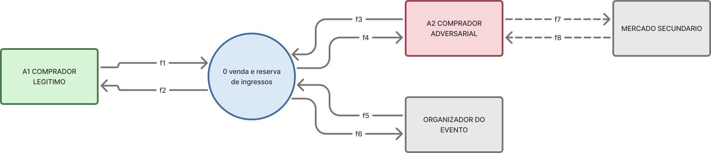
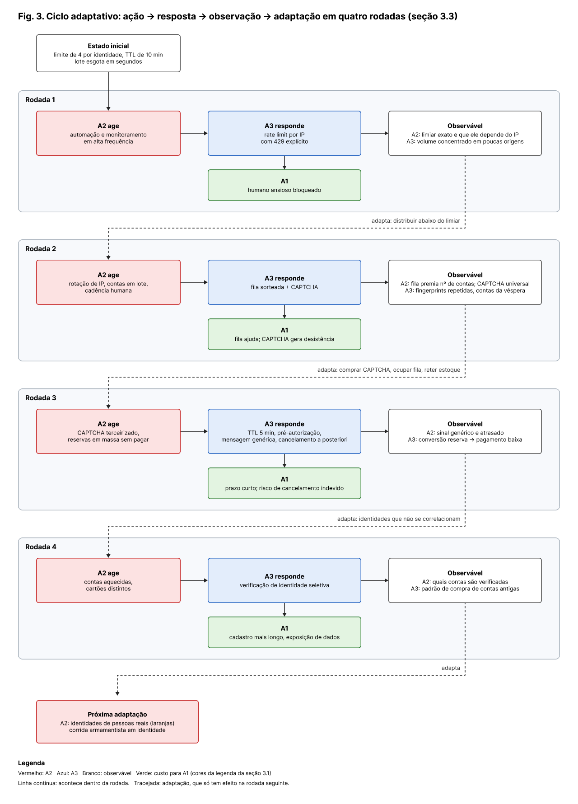
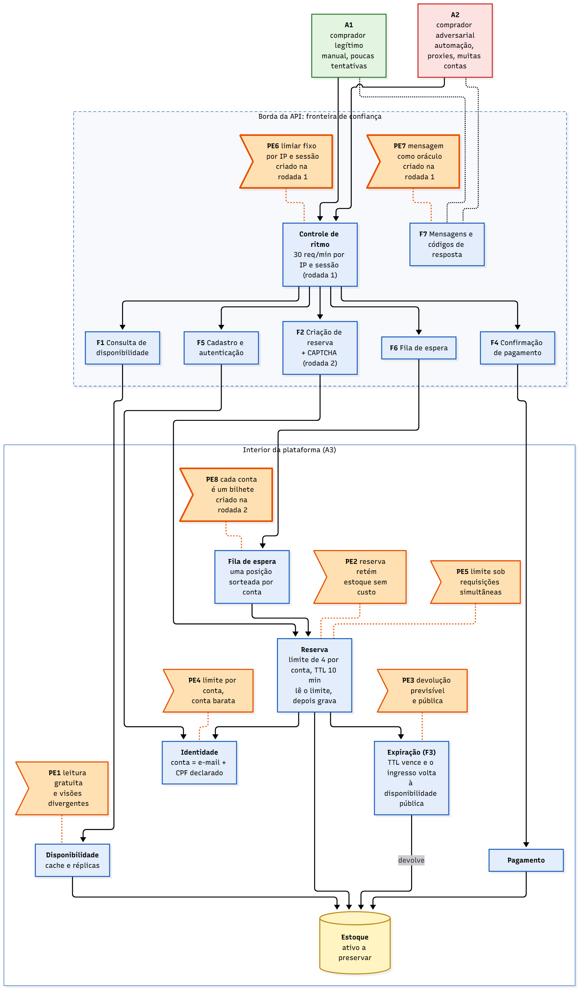
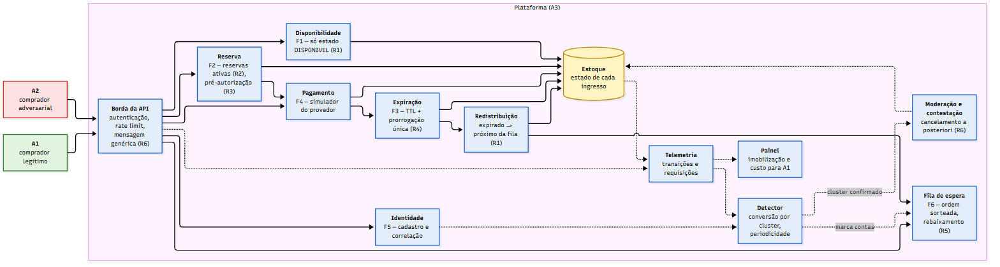

# Trabalho 1 — Análise de um Sistema Adversarial

**Universidade Federal do Pampa (Unipampa) — Engenharia de Software Adversarial**

**Sistema analisado:** plataforma de venda e reserva de ingressos — disputa por ingressos
de um evento de alta demanda.

### A pergunta que este trabalho responde

> **O que torna esse sistema adversarial, como os participantes tomam decisões e como a
> interação evolui ao longo das rodadas?**

O sistema é adversarial porque um comprador que automatiza tentativas (**A2**) lucra com
as regras de venda **funcionando exatamente como projetadas**, e porque a plataforma
(**A3**) não consegue distingui-lo do comprador legítimo (**A1**) no momento em que
precisa decidir. Os dois decidem sob informação incompleta e assimétrica: A2 observa o
*resultado* das regras e infere as regras; A3 observa o *comportamento* de A2, mas não sua
identidade nem sua intenção. A interação evolui porque **toda resposta da plataforma é
também um sinal** — cada bloqueio, código de erro ou CAPTCHA ensina A2 onde está o limiar,
e cada defesa nova vira uma regra nova que pode ser explorada. O resultado é uma escalada
em que o recurso em disputa migra de velocidade para contas, e de contas para pessoas, com
o custo recaindo progressivamente sobre A1.

### Sumário

| Seção | Resumo no README | Documento completo |
|---|---|---|
| 3.1 Descrição do sistema adversarial | [ir](#31-descrição-do-sistema-adversarial) | [`docs/contexto.md`](docs/contexto.md) |
| 3.2 Modelo estratégico estático | [ir](#32-modelo-estratégico-estático) | [`docs/modelo-estatico.md`](docs/modelo-estatico.md) |
| 3.3 Modelo estratégico dinâmico | [ir](#33-modelo-estratégico-dinâmico) | [`docs/modelo-dinamico.md`](docs/modelo-dinamico.md) |
| 3.4 Superfície de ataque | [ir](#superfície-de-ataque) | [`docs/superficie-ataque.md`](docs/superficie-ataque.md) |
| 3.4 Cenários de ameaça e riscos | [ir](#cenários-de-ameaça-e-riscos) | [`docs/ameacas.md`](docs/ameacas.md), [`docs/riscos.md`](docs/riscos.md) |
| Resiliência e arquitetura do T2 | [ir](#resiliência-resposta-e-arquitetura-do-trabalho-2) | [`docs/resiliencia.md`](docs/resiliencia.md), [`docs/decisoes-arquitetura.md`](docs/decisoes-arquitetura.md) |
| Pergunta final | [ir](#pergunta-final) | — |
| Contribuições, referências e uso de IA | [ir](#contribuições-individuais) | [`fontes/referencias.md`](fontes/referencias.md) |

---

## 3.1 Descrição do sistema adversarial

> **Desenvolvimento completo em [`docs/contexto.md`](docs/contexto.md):** delimitação de
> escopo, repertório detalhado de ações e observáveis de cada ator, tabela de custos e
> restrições, a figura complementar do fluxo interno com a legenda da notação, o dicionário
> fluxo a fluxo e as interfaces de fronteira F1–F7. Abaixo, o resumo.

### A interação analisada

O sistema é uma plataforma de venda e reserva de ingressos, e o recorte é uma única
interação:

> **A tentativa de um comprador obter um ingresso para um evento de alta demanda, durante
> a janela de abertura das vendas, enquanto a plataforma aplica regras de controle de
> disponibilidade para distribuir um estoque finito.**

O fluxo tem três passos — **consultar** a disponibilidade de um setor, **reservar** o
ingresso por um prazo (TTL) e **confirmar** o pagamento. Se o pagamento não ocorre no prazo,
a reserva expira e o ingresso volta ao estoque. Catálogo de eventos, emissão fiscal,
check-in na portaria, reembolso e o mercado secundário em si ficam fora do escopo.

**Ativo a preservar:** a **distribuição justa e controlada do estoque finito de ingressos** —
a alocação deve resultar das regras anunciadas pela plataforma, e não da capacidade técnica
de automatizar tentativas. Ativos derivados: disponibilidade do estoque, integridade das
reservas e confiança no processo de venda.

### Elementos principais

| Ator | Objetivo | Ações ou capacidades | Informações observáveis | Restrições ou custos |
|---|---|---|---|---|
| **A1 — Comprador legítimo** | Obter o ingresso desejado com esforço razoável | Consultar, reservar, pagar, aguardar na fila, desistir — sempre manualmente, pela interface | Disponibilidade exibida, resultado da tentativa, posição na fila, TTL restante | Baixa tolerância a atrito; prazo curto para pagar; precisa estar online no horário exato |
| **A2 — Comprador adversarial** (cambista/bot) | Capturar o máximo de ingressos de alto valor ao menor custo e risco | Tudo de A1, mais automação, paralelismo, múltiplas identidades e rotação de IP/dispositivo | Tudo de A1, mais latência, códigos de resposta e qual identidade caiu após quantas tentativas | Infraestrutura e contas, risco de banimento, capital imobilizado, janela temporal estreita |
| **A3 — Plataforma** (defensor) | Distribuir o estoque conforme as regras anunciadas, sem bloquear quem é legítimo | Limite por identidade, TTL, *rate limiting*, fila de espera, CAPTCHA, telemetria, cancelamento | Volume e cadência das requisições, *fingerprint* e origem, histórico, conversão reserva→pagamento | Custo alto do falso positivo; **não sabe, ao decidir, se quem solicita é A1 ou A2** |

Atores de contexto, não modelados como jogadores: o **organizador do evento**, que pressiona
pela venda rápida e limita o atrito aceitável, e o **mercado secundário**, que define o
retorno esperado de A2.

A assimetria central: **A2 observa o resultado das regras e pode inferi-las; A3 observa o
comportamento de A2, mas não sua identidade nem sua intenção.**

### Pressupostos e como podem falhar

- **P1 — uma identidade corresponde a uma pessoa.** Falha com contas criadas em massa,
  documentos de terceiros e contas compradas: o limite por identidade deixa de limitar.
- **P2 — uma reserva não paga volta a circular e beneficia outro comprador.** Falha com
  reservas em massa sem intenção de pagar: o estoque volta, mas para quem monitora em alta
  frequência. O TTL vira negação de serviço sobre o estoque.
- **P3 — a cadência das requisições distingue humano de bot.** Falha nos dois sentidos: o bot
  insere atrasos e imita o humano, e o humano ansioso no pico parece bot.
- **P4 — a disponibilidade exibida é única e fiel ao estoque real.** Falha por cache e
  réplicas com atraso: quem consulta a API direto vê o lote antes de quem usa o site.
- **P5 — o custo de tentar é semelhante para todos.** Falha porque a automação zera o custo
  marginal da tentativa para A2, mas não para A1 — tratamento igual sobre capacidades
  desiguais não produz resultado justo.

Todos colocam em risco a justiça da alocação; **P2** atinge também a disponibilidade do
estoque e **P3**, a confiança no processo.

### Diagrama de contexto



DFD nível 0: o **processo 0** no centro é o sistema inteiro, as **entidades externas** são
retângulos e as setas são fluxos de dados rotulados apenas com o identificador. Depósitos de
dados não existem em nível 0 — por isso o estoque de ingressos, que é o ativo central,
aparece só na figura complementar, em [`docs/contexto.md`](docs/contexto.md).

| Fluxos | Entre | Conteúdo |
|---|---|---|
| **f1 / f2** | A1 ↔ Sistema | Consulta de disponibilidade, pedido de reserva e confirmação de pagamento; de volta, disponibilidade exibida, resultado da tentativa, posição na fila e TTL restante |
| **f3 / f4** | A2 ↔ Sistema | As mesmas requisições e respostas, porém automatizadas e lidas como sinal de calibragem: latência, status, qual identidade caiu e após quantas tentativas |
| **f5 / f6** | Organizador ↔ Sistema | Estoque, lotes, preços e data de abertura; de volta, relatório de vendas e desempenho do lote |
| **f7 / f8** | A2 ⇢ Mercado secundário | Ingressos capturados, colocados à venda com sobrepreço; de volta, o preço de revenda praticado, que define o retorno esperado de A2 |

> **f2 e f4 carregam exatamente o mesmo conteúdo.** Essa é a assimetria central: a plataforma
> não consegue responder de forma diferente a A1 e A2, porque no momento da resposta não sabe
> qual dos dois está do outro lado. O mesmo dado que orienta o comprador legítimo ensina o
> adversário onde está o limiar de detecção.

**Desvio declarado:** em DFD estrito, fluxos ligam entidade a processo, nunca entidade a
entidade. **f7** e **f8** violam essa regra e por isso aparecem tracejados. O desvio é
deliberado — esse par é o ciclo econômico que sustenta o incentivo de A2, e sem ele o
diagrama não explicaria por que existe um adversário.

### Por que este caso é adversarial, e não um erro

Um *bug* de concorrência que vende o mesmo assento duas vezes é um defeito: ninguém escolheu
que acontecesse e ele não reage à correção. O caso aqui é diferente:

1. **Há intenção e escolha** — A2 avalia custo, retorno e risco, e decide.
2. **Os objetivos conflitam de fato** — o estoque é finito; cada ingresso capturado por A2 é
   um ingresso a menos para A1.
3. **A regra é o alvo, não o obstáculo acidental** — A2 usa o sistema exatamente como
   projetado, em volume que o projeto não previu. Não há erro a corrigir, há um incentivo a
   redesenhar.
4. **Há aprendizado dos dois lados** — cada bloqueio, CAPTCHA ou mensagem de erro informa A2
   sobre onde está o limiar, e cada defesa nova produz uma contramedida nova.
5. **A defesa tem custo sobre terceiros** — endurecer a regra contra A2 atinge A1, porque A3
   não consegue distingui-los no momento da decisão.

---

## 3.2 Modelo estratégico estático

> **Desenvolvimento completo em [`docs/modelo-estatico.md`](docs/modelo-estatico.md):**
> justificativa detalhada de cada payoff, cálculo do equilíbrio misto e limitações. Abaixo,
> o resumo.

A decisão central é modelada como um jogo entre **A2 (comprador adversarial)** e
**A3 (plataforma)**, em uma única interação na abertura das vendas, sem que um jogador
observe a escolha do outro. A1 não é jogador; os efeitos sobre ele entram na avaliação dos
resultados.

**Ações**

- **A2 — Regular (R):** poucas tentativas, sem escalar por automação ou múltiplas
  identidades. **Intensivo (I):** automatiza e paraleliza consultas e reservas, podendo usar
  múltiplas identidades.
- **A3 — Permitir (P):** processa as solicitações com os controles ordinários, sem barreira
  reforçada. **Controlar (C):** acrescenta limitação de ritmo, fila ou verificação para
  reduzir tentativas em escala.

**Matriz de payoffs** — par na ordem **(A2, A3)**, escala ordinal de 0 a 4 (maior = mais
preferido; não são valores monetários nem probabilidades):

| A2 \ A3 | Permitir (P) | Controlar (C) |
|---|---:|---:|
| **Regular (R)** | **(3, 3)** | **(2, 1)** |
| **Intensivo (I)** | **(4, 0)** | **(1, 2)** |

- **(R, P) = (3, 3):** A2 tem chance razoável a baixo custo; A3 mantém a experiência fluida.
- **(R, C) = (2, 1):** A2 enfrenta barreiras sem motivo; A3 paga custo operacional e arrisca
  falsos positivos sobre A1.
- **(I, P) = (4, 0):** A2 converte escala em vantagem sobre o estoque; A3 perde a justiça da
  alocação, e A1 perde acesso.
- **(I, C) = (1, 2):** os controles encarecem A2; A3 protege o estoque, mas ainda paga custo
  e risco de atrasar ou bloquear A1.

**Melhores respostas:** se A3 permite, A2 prefere Intensivo (`4 > 3`); se A3 controla, A2
prefere Regular (`2 > 1`). Se A2 é Regular, A3 prefere Permitir (`3 > 1`); se A2 é
Intensivo, A3 prefere Controlar (`2 > 0`).

**Estratégia dominante:** nenhum jogador tem — a melhor ação de cada um depende da ação do
outro.

**Equilíbrio:** não há resultado em estratégias puras no qual nenhum jogador melhore mudando
sozinho; em toda célula, pelo menos um tem incentivo a desviar. Há um **equilíbrio misto**
com cada jogador escolhendo cada ação com probabilidade 1/2 — propriedade matemática dos
payoffs adotados, não previsão de comportamento real.

**É bom para o sistema e para A1?** Nenhuma combinação é estável. Sem controle, A2 escala e
a distribuição deixa de ser justa; com controle, A3 reduz a vantagem de A2 mas impõe custo e
atrito a A1, que A3 não consegue distinguir de A2 — o controle gera falsos positivos. A
melhor decisão depende sempre da escolha do outro, e é essa instabilidade que a seção 3.3
desenvolve em rodadas.

## 3.3 Modelo estratégico dinâmico

> **Desenvolvimento completo em [`docs/modelo-dinamico.md`](docs/modelo-dinamico.md):** o
> passo a passo de cada rodada, o que cada uma herda da anterior e os limites do modelo.
> Abaixo, o resumo.

A matriz do 3.2 não tem equilíbrio puro: as melhores respostas giram em ciclo. Na interação
real, A2 não recua diante do controle: **mantém o objetivo e muda a ação**, contornando o
controle, e o repertório de ações cresce a cada rodada. Uma rodada é uma abertura de vendas
e percorre o ciclo **ação → resposta → observação → adaptação**.

**Estado inicial:** limite de 4 ingressos por identidade, TTL de 10 minutos, sem controle de
ritmo; o lote esgota em segundos para poucas origens automatizadas — célula (I, P) do 3.2.
Os limiares numéricos abaixo são ilustrativos.

| Rodada | Ação do participante (A2) | Resposta do sistema ou defensor (A3) | O que se torna observável? | Adaptação para a rodada seguinte | Custo para A1 |
|-:|---|---|---|---|---|
| **1** | Automação e monitoramento de alta frequência, poucas contas | *Rate limit* por IP (30 req/min) com 429 explícito | **A2:** limiar exato e a variável que o controla (IP). **A3:** volume concentrado em poucas origens | **A2:** distribuir abaixo do limiar. **A3:** registrar *fingerprint* e idade das contas | Humano ansioso bloqueado (falso positivo, P3) |
| **2** | Rotação de IP, contas criadas em lote, cadência humana | Fila sorteada + CAPTCHA na reserva | **A2:** fila premia número de contas; CAPTCHA é custo fixo. **A3:** *fingerprints* repetidas, contas da véspera | **A2:** terceirizar CAPTCHA, multiplicar contas, reter estoque. **A3:** medir conversão por cluster | Fila ajuda; CAPTCHA gera desistência |
| **3** | Reservas em massa sem pagamento (P2, OAT-021), CAPTCHA terceirizado | TTL de 5 min, limite por cluster, pré-autorização, mensagem genérica, cancelamento *a posteriori* | **A2:** sinal genérico e atrasado. **A3:** ciclo de 10 min some, conversão sobe | **A2:** identidades que não se correlacionam. **A3:** analisar padrão de compra | Prazo curto, exclusão de quem não tem cartão, risco de cancelamento indevido |
| **4** | Contas antigas compradas, cartões distintos (P1) | Verificação de identidade seletiva | **A2:** quais contas são verificadas. **A3:** abandono na etapa de verificação | **A2:** identidades de pessoas reais (laranjas) abaixo do critério | Cadastro mais longo, exposição de dados |

As rodadas mostram que:

- **a resposta produz informação** — o 429 da rodada 1 entrega o limiar a A2 (f2 = f4);
- **o objetivo se mantém e a ação muda** — A2 quer sempre o mesmo estoque, e troca de meio a cada rodada;
- **o defensor também observa e adapta** — cada resposta de A3 nasce de uma anomalia da rodada anterior;
- **decisões passadas mudam as possibilidades** — A2 só fica abaixo do limiar porque a rodada 1 o revelou; a fila sorteada da rodada 2 transformou contas em bilhetes e criou o cluster que denuncia A2 na rodada 3;
- **a defesa custa a A1** — os controles se somam e consomem o orçamento de atrito do comprador legítimo.

A virada é a rodada 3: A3 passa a controlar **a informação**, não só a regra. Mensagem
genérica, cancelamento *a posteriori* e marcação silenciosa degradam o sinal de A2 — e
também a transparência para A1.

### Diagrama do ciclo adaptativo



Fonte editável em `diagramas/ciclo-adaptativo.mmd` (Mermaid). Cores da legenda do 3.1:
vermelho A2, azul A3, branco observável, verde A1. Setas contínuas ocorrem dentro da rodada;
tracejadas são a adaptação para a seguinte.

### Perguntas de fechamento

- **Quem observa quem?** A3 observa o comportamento de A2, não sua identidade nem sua
  intenção. A2 observa as respostas de A3, não as regras. A1 vê as mesmas respostas que A2,
  sem poder usá-las como experimento.
- **O que cada lado consegue mudar?** A2 muda *como* tenta: velocidade, origens, número e
  qualidade das identidades, e o objetivo tático (comprar ou reter). A3 muda as regras e,
  desde a rodada 3, quanta informação cada resposta carrega. Nenhum dos dois controla o
  preço de revenda (f8).
- **O que dispara uma adaptação?** Para A2, a queda na taxa de sucesso de uma estratégia.
  Para A3, uma anomalia agregada confirmada ao longo de uma abertura: esgotamento em
  segundos, *fingerprints* repetidas, conversão baixa, contas antigas que só compram em
  alta demanda.
- **Qual é o custo da adaptação?** Para A2: infraestrutura, identidades cada vez mais caras
  (em lote → aquecidas → pessoas reais), resolução de CAPTCHA, capital retido e perdas por
  cancelamento. Para A3: operação dos controles, moderação e perda de transparência — e o
  atrito e os falsos positivos impostos a A1, que voltam como perda de receita e reputação.
- **Onde surge a corrida armamentista?** No CAPTCHA (rodadas 2–3), que A2 compra pronto e
  cujo endurecimento pesa mais sobre A1 do que sobre A2; e, de forma mais grave, na
  identidade (rodadas 3–4 em diante): correlação → contas aquecidas → verificação →
  laranjas. A corrida só se estabiliza quando o custo por ingresso de A2 supera a margem de
  revenda — por isso A3 não precisa detectar todo A2, e sim encarecer o que A2 não consegue
  automatizar sem consumir o orçamento de atrito de A1.

## 3.4 Ameaças e riscos

### Superfície de ataque

> **Desenvolvimento completo em [`docs/superficie-ataque.md`](docs/superficie-ataque.md):** a cadeia componente → interface → regra → ponto de cada um dos oito pontos, o que A2 aprende em cada um, a cobertura de interfaces e pressupostos e as cadeias de exploração. Abaixo, o resumo.

A superfície analisada é a do sistema antes do redesenho: as regras do estado inicial do 3.3 (limite de 4 por identidade, TTL de 10 minutos) mais os controles das rodadas 1 e 2 (limite por IP com `429`, fila sorteada, CAPTCHA). A fronteira de confiança é a **Borda da API**: tudo o que vem do cliente (IP, cadência, cadastro, momento da requisição) é controlado pelo comprador e pode ser repetido a custo quase zero (P5).

Cada ponto liga uma funcionalidade à regra de que ela depende: "a funcionalidade X depende da regra Y, criando o ponto de exploração Z".

| Ponto | Componente | Interface | Regra explorada | Pressuposto ou fraqueza | Rodada | Origem |
|---|---|---|---|---|-:|---|
| **PE1** Leitura gratuita e visões divergentes | Disponibilidade | F1 | Consulta sem custo nem limite, servida de cache | P4, P5 | 1 | Projeto original |
| **PE2** Reserva retém estoque sem custo | Reserva | F2 (e F4) | Reservar é grátis e não há limite de reservas ativas | P2, P5 | 3 | Projeto original |
| **PE3** Devolução previsível e pública | Expiração | F3 → F1 | O ingresso volta à disponibilidade pública quando o TTL fixo vence | P2, P4 | 3 | Projeto original |
| **PE4** Limite por conta, conta barata | Identidade, Reserva | F5, F2 | Limite de 4 por conta; conta sem verificação de pessoa | P1 | 2, 4 | Projeto original |
| **PE5** Limite sob requisições simultâneas | Reserva | F2 | O limite é lido e depois gravado, sem atomicidade | Fraqueza de implementação; P5 | n/a | Projeto original |
| **PE6** Limiar fixo por IP | Borda da API | F1, F2 | 30 req/min contadas por IP e por sessão | P3, P5 | 1, 2 | Criado na rodada 1 |
| **PE7** Mensagem como oráculo | Borda da API (respostas) | F7 | Rejeição com código específico e determinística | P3 | 1 | Criado na rodada 1 |
| **PE8** Cada conta é um bilhete | Fila de espera | F6 | Uma posição sorteada por conta | P1, P5 | 2, 3 | Criado na rodada 2 |

Todas as interfaces F1 a F7 e todos os pressupostos P1 a P5 têm pelo menos um ponto. Os pontos rendem mais quando encadeados: **PE2 → PE3 → PE1** é a imobilização com recaptura (base da ameaça prioritária), **PE4 → PE8** com PE5 é a escala por identidades, e **PE7 → PE6 → PE4** é a calibragem pelos limiares.

**A superfície cresce com a defesa.** PE6, PE7 e PE8 não existiam no estado inicial: foram criados pelas respostas de A3 nas rodadas 1 e 2. Toda defesa é também uma regra, e toda regra que A2 consegue observar passa a fazer parte da superfície.



Fonte editável em `diagramas/superficie-de-ataque.mmd` (Mermaid). Cores da legenda do 3.1; bandeiras laranja são os pontos de exploração, ligados por linha pontilhada ao componente onde a regra explorada está. Contorno grosso marca os pontos criados pela defesa.

### Cenários de ameaça e riscos

> **Desenvolvimento completo em [`docs/ameacas.md`](docs/ameacas.md)** (como cada cenário
> acontece, por que é adversarial e não erro, rastreabilidade) **e
> [`docs/riscos.md`](docs/riscos.md)** (escala, critérios de cada nível e justificativa das
> notas). Os IDs são `T1`–`T3` porque `A1`–`A3` já são os atores da seção 3.1.

Cada cenário parte de uma cadeia de pontos de exploração acima:

- **T1 — Imobilização e recaptura.** Um **comprador adversarial (A2)** pode **abrir reservas
  em massa sem intenção de pagar, deixá-las expirar e reservar de novo o ingresso quando ele
  volta** por meio de **PE2 → PE3 → PE1**, aproveitando **P2** (reserva não paga volta a
  circular para outro comprador), causando **a retirada do estoque de circulação e sua
  concentração em quem monitora em alta frequência** sobre a **disponibilidade do estoque
  e a justiça da alocação**.
- **T2 — Escala por identidades.** Um **comprador adversarial (A2)** pode **multiplicar
  contas para multiplicar o limite de 4 ingressos e as posições na fila, com requisições
  simultâneas para passar do limite** por meio de **PE4 → PE8, com PE5**, aproveitando
  **P1** (uma identidade é uma pessoa) **e a verificação do limite sem atomicidade**,
  causando **o desvio do lote para quem controla mais contas** sobre a **justiça da
  alocação e a integridade das reservas**.
- **T3 — Calibragem pelos limiares.** Um **comprador adversarial (A2)** pode **usar as
  mensagens de rejeição para descobrir os limiares e operar logo abaixo deles, rotacionando
  IPs e contas** por meio de **PE7 → PE6 → PE4**, aproveitando **P3** (a cadência revela se
  o agente é humano), causando **a perda de efeito da detecção e o bloqueio de compradores
  legítimos** sobre a **justiça da alocação e a confiança no processo**.

| ID | Cenário | Ponto de exploração | Pressuposto ou fraqueza | Ativo afetado | P | I | Risco |
|---|---|---|---|---|-:|-:|-:|
| **T1** | Imobilização e recaptura | PE2 → PE3 → PE1 (F2, F3, F1) | P2, P4, P5 | Disponibilidade do estoque, justiça da alocação | 3 | 3 | **9** |
| **T2** | Escala por identidades | PE4 → PE8, com PE5 (F5, F6, F2) | P1, P5; verificação do limite sem atomicidade | Justiça da alocação, integridade das reservas | 2 | 3 | **6** |
| **T3** | Calibragem pelos limiares | PE7 → PE6 → PE4 (F7, F1, F2) | P3, P5 | Justiça da alocação, confiança no processo | 3 | 2 | **6** |

Risco = probabilidade × impacto, cada um de 1 a 3; 6–9 é alto, 3–4 médio, 1–2 baixo.

## Resiliência, resposta e arquitetura do Trabalho 2

> **Desenvolvimento completo em [`docs/resiliencia.md`](docs/resiliencia.md):** os seis
> controles com a interface que cada um afeta, os indicadores de observabilidade, o
> vazamento de informação controle a controle, as mitigações para A1 e os componentes do
> Trabalho 2. Escala e pontuação em [`docs/riscos.md`](docs/riscos.md); invariantes,
> registros de decisão e critérios de aceite do protótipo em
> [`docs/decisoes-arquitetura.md`](docs/decisoes-arquitetura.md). Abaixo, o resumo.

**Ameaça prioritária:** imobilização de estoque (T1) — A2 abre reservas em massa sem
intenção de pagar e recaptura o ingresso quando ele expira, pela cadeia **PE2 → PE3 → PE1**,
explorando **P2** (OWASP OAT-021). Risco **9 (3 × 3)**: reservar não custa nada e a ameaça
atinge ao mesmo tempo a disponibilidade e a justiça da alocação. É a prioritária porque os
demais cenários pontuados, T2 e T3, ficam em 6.

**Resposta.** A rodada 3 do 3.3 encarece a imobilização; o redesenho ataca a falha do
pressuposto — o estoque liberado voltava para quem monitora em alta frequência.

| # | Controle | O que ataca |
|-:|---|---|
| **R1** | Ingresso expirado é oferecido ao próximo da fila sorteada, sem voltar à disponibilidade pública | A recaptura |
| **R2** | Limite de reservas ativas por conta e por cluster | A escala: *n* ingressos retidos exigem *n* identidades |
| **R3** | Pré-autorização do cartão na reserva, ou Pix imediato | O custo zero de reservar sem pagar (P5) |
| **R4** | TTL curto com prorrogação única se o pagamento já começou | O tempo de imobilização, sem punir quem paga devagar |
| **R5** | Expirações repetidas levam ao fim da fila no evento, sem bloqueio | A repetição do ciclo, com penalidade reversível |
| **R6** | Mensagem genérica e cancelamento *a posteriori* só para cluster confirmado | O aprendizado de A2 sobre os limiares |

A observabilidade mede os dois lados: conversão reserva → pagamento por cluster, fração do
estoque em reserva ativa e periodicidade da disponibilidade (o ataque), e desistência e
contestações de A1 (o custo da defesa).

**As seis perguntas da ameaça prioritária:**

1. **Como responder?** R1–R6. O objetivo não é impedir A2 de comprar, e sim tirar a
   imobilização do repertório: se reter não rende, A2 só ganha comprando de verdade.
2. **Que informação a resposta revela?** R1–R3 são regras anunciadas, e conhecê-las não
   ajuda a contorná-las. R5 e R6 são detecção, e por isso dão sinal genérico e atrasado — o
   erro da rodada 1 foi expor o limiar de uma detecção.
3. **Como A2 se adapta?** Pulveriza reservas em identidades reais, absorve a
   pré-autorização com capital e cartões virtuais, paga uma fração para camuflar a
   conversão, multiplica posições na fila ou troca imobilização por compra. Todas levam ao
   custo de identidade: a disputa migra de P2 para P1.
4. **Efeitos sobre A1?** Quem não tem cartão (mitigado pelo Pix), quem paga devagar
   (prorrogação), quem tem cartão recusado (penalidade só após várias expirações) e, o mais
   grave, o cancelamento indevido (só para cluster confirmado, com contestação). Quem
   reserva e paga em tempo não vê nenhum passo novo.
5. **Risco residual?** Imobilização em escala menor com identidades reais, atraso de
   detecção, adversário com capital, falsos positivos e acumulação por compra. O risco cai
   de **9 para 4 (2 × 2, médio)**; baixar mais exige atuar sobre P1 (rodada 4).
6. **O que preservar?** Alocação pelas regras anunciadas; uma reserva = um ingresso;
   todo estoque liberado volta a circular em tempo limitado; um caminho para A1 sem meios
   especiais; penalidades proporcionais e reversíveis; o custo da defesa medido junto com o
   ataque.

### Arquitetura do Trabalho 2



Fonte editável em `diagramas/arquitetura-t2.mmd` (Mermaid). Cada componente implementa um
ou mais controles R1–R6; linhas contínuas são requisições e transições de estado, tracejadas
são telemetria e detecção. O núcleo é a máquina de estados do ingresso
(`DISPONIVEL → RESERVADO → VENDIDO`, com expiração para `OFERTADO_FILA`): é ela que garante
que o ingresso expirado nunca fique visível a quem monitora a disponibilidade.

---

## Pergunta final

> **Depois que o sistema responder, o que o outro lado aprenderá e tentará fazer em
> seguida?**

Depois da resposta R1–R6 à imobilização de estoque (T1), A2 aprende três coisas, nessa
ordem:

1. **Que a recaptura morreu, e aprende isso rápido.** R1 manda o ingresso expirado para a
   fila em vez de devolvê-lo à disponibilidade pública, então monitorar F1 em alta
   frequência deixa de render. É um aprendizado que A3 *quer* que aconteça: quanto antes
   A2 concluir que reter não paga, antes ele sai do repertório da imobilização.
2. **Que o gargalo virou a identidade.** Com uma reserva ativa por conta (R2) e
   pré-autorização no ato da reserva (R3), imobilizar *n* ingressos passa a exigir *n*
   identidades com cartão próprio. A disputa migra de **P2** (a reserva volta a circular)
   para **P1** (uma identidade é uma pessoa) — exatamente a rodada 4 do modelo dinâmico.
3. **Que o sinal ficou pior, mas não sumiu.** R5 e R6 dão resposta genérica e atrasada, e
   A2 não consegue mais ligar causa a efeito em uma tentativa isolada. Em compensação,
   comparando muitas contas ao longo de várias aberturas, ele ainda estima o critério que
   agrupa contas em um *cluster* e o número de expirações que derruba a posição na fila.

**O que ele tentará fazer:** pulverizar as reservas em identidades reais que não se
correlacionam, absorver a pré-autorização com capital e cartões virtuais, pagar uma fração
das reservas só para manter a conversão do *cluster* acima do limiar de suspeita, e — a
adaptação mais interessante — **ocupar a fila em vez do estoque**, porque R1 acabou de
transformar cada posição na fila também em um bilhete para os ingressos devolvidos. A
própria defesa fortaleceu PE8.

**E é por isso que a resposta não é uma solução.** O risco de T1 cai de 9 para 4, não para
zero, e o que sobra reaparece com outro nome: é o cenário T2, escala por identidades. A
resposta seguinte de A3 (verificação seletiva) move a disputa mais um degrau, de contas
para pessoas, e cada degrau é mais caro para os dois lados e mais invasivo para A1. O ciclo
não termina — o que A3 pode fazer é escolher **onde** ele continua, garantindo que o
próximo degrau custe mais a A2 do que ao comprador legítimo, e medir as duas coisas juntas.

---

## Estrutura do repositório

```text
sistema-ingresso-adversarial/
├── README.md                     relatório principal
├── docs/
│   ├── contexto.md               3.1
│   ├── modelo-estatico.md        3.2
│   ├── modelo-dinamico.md        3.3
│   ├── superficie-ataque.md      3.4        superfície de ataque
│   ├── ameacas.md                3.4        cenários de ameaça
│   ├── riscos.md                 3.4        escala e pontuação
│   ├── resiliencia.md            resiliência e arquitetura do T2
│   ├── decisoes-arquitetura.md   invariantes e decisões verificáveis do T2
│   └── Enunciado.md              cópia do enunciado, para referência
├── diagramas/                    cada figura em .svg + .png; os documentos usam o .png
│   ├── contexto.png              Fig. 1 - DFD nivel 0        (fonte: board FigJam)
│   ├── contexto-fluxo.png        Fig. 2 - fluxo interno      (fonte: board FigJam)
│   ├── contexto-legenda.png      legenda das duas            (fonte: board FigJam)
│   ├── ciclo-adaptativo.mmd      Fig. 3 - fonte editavel     (+ .svg, .png)
│   ├── superficie-de-ataque.mmd  Fig. 4 - fonte editavel     (+ .svg, .png)
│   └── arquitetura-t2.mmd        Fig. 5 - fonte editavel     (+ .svg, .png)
└── fontes/
    └── referencias.md            colaborativo
```

## Contribuições individuais

Derivada do histórico do repositório; cada contribuição abaixo é rastreável por
`git log --author=...`.

| Integrante | Seções | Artefatos |
|---|---|---|
| **Guilherme Mundt** | 3.1 — descrição do sistema adversarial | `docs/contexto.md` (delimitação da interação, atores A1–A3, ativos, capacidades e observáveis, restrições, pressupostos P1–P5, interfaces F1–F7, dicionário de fluxos f1–f8), `diagramas/contexto.*`, `contexto-fluxo.*` e `contexto-legenda.*`, resumo da 3.1 no README e referências da seção |
| **Talysson Aguinario** | 3.2 — modelo estratégico estático | `docs/modelo-estatico.md` (jogo A2 × A3, ações R/I e P/C, matriz de payoffs e justificativa, melhores respostas, ausência de estratégia dominante, equilíbrio em estratégias mistas e limitações) |
| **Pietro Prauchner** | 3.3 — modelo estratégico dinâmico | `docs/modelo-dinamico.md` (ciclo ação → resposta → observação → adaptação, quatro rodadas com custo para A1, condição econômica da corrida armamentista e perguntas de fechamento), `diagramas/ciclo-adaptativo.*`, resumos da 3.2 e da 3.3 no README, declaração de uso de IA e `docs/Enunciado.md` |
| **Rafaela Nunes** | 3.4 — superfície de ataque | `docs/superficie-ataque.md` (fronteira de confiança, pontos de exploração PE1–PE8, cobertura de interfaces e pressupostos, cadeias de exploração), `diagramas/superficie-de-ataque.*`, resumo no README e referências da seção |
| **Lorenzo Ficher** | 3.4 — cenários e riscos; resiliência | `docs/ameacas.md` (cenários T1–T3 e rastreabilidade), `docs/riscos.md` (escala de risco, pontuação dos cenários, ameaça prioritária e risco residual), `docs/resiliencia.md` (controles R1–R6 ligados aos pontos de exploração, observabilidade, adaptação, efeitos colaterais e arquitetura do Trabalho 2), `diagramas/arquitetura-t2.*` e os resumos correspondentes no README |
| **Inaurrara Rozado** | Arquitetura do Trabalho 2 | `docs/decisoes-arquitetura.md` (invariantes do domínio INV1–INV7, registros de decisão DA1–DA5, comportamento sob falha e critérios de aceite do protótipo), refinamento de `docs/resiliencia.md` e do diagrama `diagramas/arquitetura-t2.*` |

## Referências

Ver [`fontes/referencias.md`](fontes/referencias.md).

## Declaração de uso de IA generativa

Conforme a seção 6 do enunciado, o grupo declara as ferramentas de IA generativa
utilizadas, as tarefas em que foram empregadas e como o conteúdo foi verificado.

| Seção | Ferramenta | Tarefa |
|---|---|---|
| 3.1 | ChatGPT (OpenAI) | *Brainstorming* da escolha do sistema e do recorte da interação |
| 3.1 | Claude (Anthropic) | Apoio à redação e estruturação |
| 3.2 | ChatGPT (OpenAI) | Apoio à redação e estruturação da matriz de payoffs, da justificativa das preferências e da análise de melhores respostas e equilíbrio |
| 3.3 | Claude (Anthropic) | Apoio à redação e estruturação do modelo dinâmico, das rodadas e do diagrama do ciclo adaptativo |
| 3.4 (superfície de ataque) | Claude (Anthropic) | Apoio à redação e estruturação dos pontos de exploração, das tabelas de rastreabilidade e do diagrama de superfície de ataque |
| 3.4 (cenários de ameaça) | Claude (Anthropic) | Apoio à redação dos cenários T1–T3 no formato do enunciado e da tabela de rastreabilidade |
| 3.4 (riscos) e resiliência | Claude (Anthropic) | Apoio à redação e estruturação da escala de risco, da pontuação dos cenários a partir dos pontos de exploração, da resposta à ameaça prioritária e do diagrama de arquitetura do Trabalho 2 |

**Como o conteúdo foi verificado:** todo texto gerado foi revisado manualmente quanto à
aderência ao enunciado, à consistência com o vocabulário fixado na seção 3.1 (atores,
pressupostos, fluxos e interfaces) e à existência e correção das fontes citadas. O grupo é
responsável por todas as decisões apresentadas e consegue explicá-las.