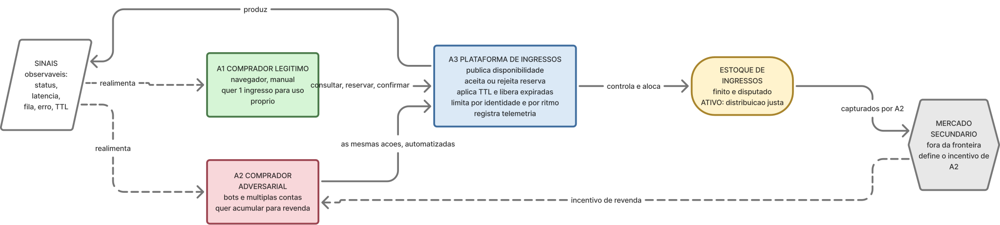
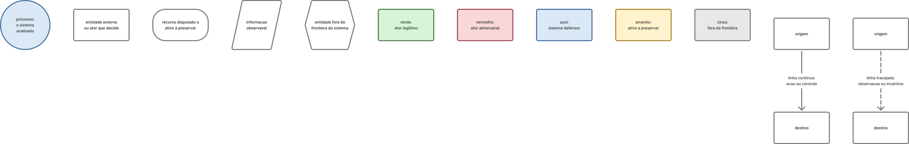

# Trabalho 1 — Análise de um Sistema Adversarial

**Sistema analisado:** plataforma de venda e reserva de ingressos — disputa por ingressos
de um evento de alta demanda.

**Disciplina:** Engenharia de Software Adversarial — Unipampa
**Modalidade:** grupo de 6 integrantes

> **Estado do documento:** em construção. A seção 3.1 está completa; as demais estão
> pendentes. A integração final do README é tarefa coletiva.

---

## 3.1 Descrição do sistema adversarial

> Síntese da seção. O desenvolvimento completo — repertório detalhado de ações, informações
> observáveis de cada ator, tabela de custos e restrições, delimitação de escopo e discussão
> da notação — está em [`docs/contexto.md`](docs/contexto.md).

### A interação analisada

O sistema é uma plataforma de venda e reserva de ingressos. **Não analisamos a plataforma
inteira**: o recorte é uma única interação.

> **A tentativa de um comprador obter um ingresso para um evento de alta demanda,
> durante a janela de abertura das vendas, enquanto a plataforma aplica regras de
> controle de disponibilidade para distribuir um estoque finito.**

O fluxo coberto tem três passos: **consultar** a disponibilidade de um setor →
**reservar** temporariamente o ingresso por um prazo (TTL) → **confirmar** o pagamento.
Se o pagamento não ocorre dentro do prazo, a reserva expira e o ingresso retorna ao
estoque. Ficam fora do escopo: catálogo de eventos, emissão fiscal, check-in na portaria,
reembolso e o mercado secundário em si.

### Atores, ativo e conflito

| Ator | Objetivo | Do que dispõe | Restrição decisiva |
|---|---|---|---|
| **A1 — Comprador legítimo** | Obter o ingresso desejado com esforço razoável | Ações manuais pela interface: consultar, reservar, pagar, aguardar na fila, desistir | Baixa tolerância a atrito; precisa estar online no horário exato da abertura |
| **A2 — Comprador adversarial** (cambista/bot) | Capturar o máximo de ingressos de alto valor ao menor custo e risco | Tudo de A1, mais automação, paralelismo, múltiplas identidades e rotação de IP/dispositivo | Custo de infraestrutura e de contas, risco de banimento, janela temporal estreita |
| **A3 — Plataforma** (defensor) | Distribuir o estoque conforme as regras anunciadas, sem bloquear quem é legítimo | Limite por identidade, TTL, *rate limiting*, fila de espera, CAPTCHA, telemetria, cancelamento | **Não sabe, no momento da decisão, se quem solicita é A1 ou A2**; o falso positivo é caro |

Atores de contexto, não modelados como jogadores: o **organizador do evento**, que pressiona
pela venda rápida e limita o atrito aceitável, e o **mercado secundário**, que define o
retorno esperado de A2.

**Ativo a preservar:**

> **A distribuição justa e controlada do estoque finito de ingressos** — a alocação deve
> resultar das regras anunciadas pela plataforma, e não da capacidade técnica de
> automatizar tentativas.

Ativos derivados: disponibilidade do estoque, integridade das reservas e confiança no
processo de venda.

A assimetria central: **A2 observa o resultado das regras e pode inferi-las; A3 observa o
comportamento de A2, mas não sua identidade nem sua intenção.** Ambos os lados aprendem
com o que veem, e nenhum enxerga o outro por completo.

### Pressupostos e como podem falhar

| ID | Pressuposto | Modo de falha | Ativo em risco |
|---|---|---|---|
| **P1** | Uma identidade corresponde a uma pessoa | Contas em massa, documentos de terceiros, contas compradas — o limite por identidade deixa de limitar | Justiça da alocação |
| **P2** | Uma reserva não paga volta a circular e beneficia outro comprador | Reservas em massa sem intenção de pagar; o estoque volta, mas para quem monitora em alta frequência. O TTL vira negação de serviço sobre o estoque | Disponibilidade do estoque |
| **P3** | A cadência de requisições distingue humano de bot | Falha nos dois sentidos: o bot imita o humano; o humano ansioso no pico parece bot | Justiça e confiança |
| **P4** | A disponibilidade exibida é única e fiel ao estoque real | Cache e réplicas com atraso; quem consulta a API direto vê o lote antes de quem usa o site | Justiça da alocação |
| **P5** | O custo de tentar é semelhante para todos | A automação zera o custo marginal da tentativa para A2, mas não para A1 — tratamento igual sobre capacidades desiguais não produz resultado justo | Justiça da alocação |

### Diagramas de contexto

**Arquivo-fonte editável das figuras:** FigJam —
<https://www.figma.com/board/57yNrenUGK0zE7HpL4JfO3>. Cada figura tem endereço próprio no
board: [Figura 1](https://www.figma.com/board/57yNrenUGK0zE7HpL4JfO3?node-id=22-141),
[Figura 2](https://www.figma.com/board/57yNrenUGK0zE7HpL4JfO3?node-id=3-71) e
[legenda](https://www.figma.com/board/57yNrenUGK0zE7HpL4JfO3?node-id=9-207).

#### Figura 1 — Diagrama de contexto (DFD nível 0)


Notação canônica: o **processo 0** no centro é o sistema inteiro, as **entidades externas**
são retângulos e as setas são **fluxos de dados** rotulados apenas com o identificador.
Depósitos de dados não existem em nível 0 — por isso o estoque de ingressos, que é o ativo
central, só aparece na Figura 2.

| Fluxos | Entre | Conteúdo |
|---|---|---|
| **f1 / f2** | A1 ↔ Sistema | Consulta de disponibilidade, pedido de reserva e confirmação de pagamento; de volta, disponibilidade exibida, resultado da tentativa, posição na fila e TTL restante |
| **f3 / f4** | A2 ↔ Sistema | As mesmas requisições e respostas, porém automatizadas, paralelizadas entre identidades e lidas como sinal de calibragem: latência, status, qual identidade caiu e após quantas tentativas |
| **f5 / f6** | Organizador ↔ Sistema | Estoque, lotes, preços e data de abertura; de volta, relatório de vendas e desempenho do lote |
| **f7 / f8** | A2 ⇢ Mercado secundário | Ingressos capturados, colocados à venda com sobrepreço; de volta, o preço de revenda praticado, que define o retorno esperado de A2 |

> **f2 e f4 carregam exatamente o mesmo conteúdo.** Essa é a assimetria central: a
> plataforma não consegue responder de forma diferente a A1 e A2, porque no momento da
> resposta não sabe qual dos dois está do outro lado. O mesmo dado que orienta o comprador
> legítimo ensina o adversário onde está o limiar de detecção.

> **Desvio declarado:** em DFD estrito, fluxos ligam entidade a processo, nunca entidade a
> entidade. **f7** e **f8** violam essa regra e por isso aparecem tracejados. O desvio é
> deliberado — esse par é o ciclo econômico que sustenta o incentivo de A2, e sem ele o
> diagrama não explicaria por que existe um adversário.

#### Figura 2 — Fluxo interno da interação (complementar)



Abre o processo 0 para mostrar o que a Figura 1 omite por convenção: o **estoque** como
recurso disputado e os **sinais observáveis** como saída que realimenta os dois compradores.
A1 e A2 atravessam a **mesma interface**, com o mesmo repertório de ações — muda a escala e
o custo marginal de cada tentativa, e é por isso que A3 não consegue separá-los no momento
da decisão. Esse laço de realimentação é o que a seção 3.3 transforma em rodadas.

#### Legenda (vale para as duas figuras)



A notação carrega três dimensões independentes: a **forma** indica o tipo de elemento
(processo, entidade externa, recurso disputado, informação observável); a **cor** indica o
papel no conflito (verde legítimo, vermelho adversarial, azul defensor, amarelo ativo,
cinza fora da fronteira); e o **traço da linha** indica a natureza do relacionamento —
contínuo para ação ou controle direto, tracejado para observação, realimentação ou
incentivo.

> A distinção entre os traços é o que dá sentido ao modelo dinâmico: **as linhas contínuas
> são o que acontece em uma rodada; as tracejadas são o que permite a adaptação para a
> rodada seguinte.**

### Por que este caso é adversarial, e não um erro

Um *bug* de concorrência que vende o mesmo assento duas vezes é um defeito: ninguém escolheu
que acontecesse e ele não reage à correção. O caso aqui é diferente:

1. **Há intenção e escolha** — A2 avalia custo, retorno e risco, e decide.
2. **Os objetivos conflitam de fato** — o estoque é finito; cada ingresso capturado por A2 é
   um ingresso a menos para A1.
3. **A regra é o alvo, não o obstáculo acidental** — A2 usa o sistema exatamente como
   projetado, em volume e velocidade que o projeto não previu. Não há erro a corrigir: há um
   incentivo a redesenhar.
4. **Há aprendizado dos dois lados** — cada bloqueio, CAPTCHA ou mensagem de erro informa A2
   sobre onde está o limiar, e cada defesa nova produz uma contramedida nova.
5. **A defesa tem custo sobre terceiros** — endurecer a regra contra A2 atinge A1, porque A3
   não consegue distingui-los no momento da decisão.

> O que torna este sistema adversarial não é a existência de uma falha, mas a existência de
> **um agente que lucra com a regra funcionando como projetada, e que reage a toda tentativa
> de impedi-lo.**

---

## 3.2 Modelo estratégico estático

> *Pendente.*
> Insumo disponível: jogadores **A2 × A3**, repertório de ações e restrições de custo em
> [`docs/contexto.md`](docs/contexto.md), seções 5 e 7.

## 3.3 Modelo estratégico dinâmico

> *Pendente.*
> Insumo disponível: assimetria de observação em [`docs/contexto.md`](docs/contexto.md),
> seção 6.

## 3.4 Ameaças e riscos

> *Pendente.*
> Insumo disponível: sete interfaces de fronteira e cinco pressupostos já mapeados entre
> si em [`docs/contexto.md`](docs/contexto.md), seções 9 e 12; ativos na seção 4.

## Resiliência, resposta e arquitetura do Trabalho 2

> *Pendente.*

---

## Estrutura do repositório

```text
sistema-ingresso-adversarial/
├── README.md                     relatório principal
├── docs/
│   ├── contexto.md               3.1
│   ├── modelo-estatico.md        3.2        (pendente)
│   ├── modelo-dinamico.md        3.3        (pendente)
│   ├── ameacas.md                3.4        (pendente)
│   ├── riscos.md                 3.4        (pendente)
│   └── resiliencia.md                       (pendente)
├── diagramas/
│   ├── contexto.svg              Fig. 1 - DFD nivel 0
│   ├── contexto-fluxo.svg        Fig. 2 - fluxo interno
│   ├── contexto-legenda.svg      legenda das duas
│   ├── ciclo-adaptativo.*                   (pendente)
│   ├── superficie-ataque.*                  (pendente)
│   └── arquitetura-t2.*                     (pendente)
└── fontes/
    └── referencias.md            colaborativo
```

## Referências

Ver [`fontes/referencias.md`](fontes/referencias.md).

## Declaração de uso de IA generativa

> *A completar coletivamente antes da entrega.*
>
> **Seção 3.1:** foram utilizados assistentes de IA generativa (ChatGPT e Claude) no
> *brainstorming* da escolha do sistema, no recorte da interação analisada e na redação
> da seção. O conteúdo foi revisado manualmente quanto à aderência ao enunciado, à
> consistência do recorte e à correção das referências citadas.
