# Trabalho 1 — Análise de um Sistema Adversarial

**Sistema analisado:** plataforma de venda e reserva de ingressos — disputa por ingressos
de um evento de alta demanda.

---

## 3.1 Descrição do sistema adversarial

> **Desenvolvimento completo em [`docs/contexto.md`](docs/contexto.md):** delimitação de
> escopo, repertório detalhado de ações e observáveis de cada ator, tabela de custos e
> restrições, a figura complementar do fluxo interno com a legenda da notação, o dicionário
> fluxo a fluxo e as interfaces de fronteira F1–F7. Abaixo, o resumo.

### A interação analisada

O sistema é uma plataforma de venda e reserva de ingressos, e o recorte é uma única
interação:

> **A tentativa de um comprador obter um ingresso para um evento de alta demanda, durante
> a janela de abertura das vendas, enquanto a plataforma aplica regras de controle de
> disponibilidade para distribuir um estoque finito.**

O fluxo tem três passos — **consultar** a disponibilidade de um setor, **reservar** o
ingresso por um prazo (TTL) e **confirmar** o pagamento. Se o pagamento não ocorre no prazo,
a reserva expira e o ingresso volta ao estoque. Catálogo de eventos, emissão fiscal,
check-in na portaria, reembolso e o mercado secundário em si ficam fora do escopo.

**Ativo a preservar:** a **distribuição justa e controlada do estoque finito de ingressos** —
a alocação deve resultar das regras anunciadas pela plataforma, e não da capacidade técnica
de automatizar tentativas. Ativos derivados: disponibilidade do estoque, integridade das
reservas e confiança no processo de venda.

### Elementos principais

| Ator | Objetivo | Ações ou capacidades | Informações observáveis | Restrições ou custos |
|---|---|---|---|---|
| **A1 — Comprador legítimo** | Obter o ingresso desejado com esforço razoável | Consultar, reservar, pagar, aguardar na fila, desistir — sempre manualmente, pela interface | Disponibilidade exibida, resultado da tentativa, posição na fila, TTL restante | Baixa tolerância a atrito; prazo curto para pagar; precisa estar online no horário exato |
| **A2 — Comprador adversarial** (cambista/bot) | Capturar o máximo de ingressos de alto valor ao menor custo e risco | Tudo de A1, mais automação, paralelismo, múltiplas identidades e rotação de IP/dispositivo | Tudo de A1, mais latência, códigos de resposta e qual identidade caiu após quantas tentativas | Infraestrutura e contas, risco de banimento, capital imobilizado, janela temporal estreita |
| **A3 — Plataforma** (defensor) | Distribuir o estoque conforme as regras anunciadas, sem bloquear quem é legítimo | Limite por identidade, TTL, *rate limiting*, fila de espera, CAPTCHA, telemetria, cancelamento | Volume e cadência das requisições, *fingerprint* e origem, histórico, conversão reserva→pagamento | Custo alto do falso positivo; **não sabe, ao decidir, se quem solicita é A1 ou A2** |

Atores de contexto, não modelados como jogadores: o **organizador do evento**, que pressiona
pela venda rápida e limita o atrito aceitável, e o **mercado secundário**, que define o
retorno esperado de A2.

A assimetria central: **A2 observa o resultado das regras e pode inferi-las; A3 observa o
comportamento de A2, mas não sua identidade nem sua intenção.**

### Pressupostos e como podem falhar

- **P1 — uma identidade corresponde a uma pessoa.** Falha com contas criadas em massa,
  documentos de terceiros e contas compradas: o limite por identidade deixa de limitar.
- **P2 — uma reserva não paga volta a circular e beneficia outro comprador.** Falha com
  reservas em massa sem intenção de pagar: o estoque volta, mas para quem monitora em alta
  frequência. O TTL vira negação de serviço sobre o estoque.
- **P3 — a cadência das requisições distingue humano de bot.** Falha nos dois sentidos: o bot
  insere atrasos e imita o humano, e o humano ansioso no pico parece bot.
- **P4 — a disponibilidade exibida é única e fiel ao estoque real.** Falha por cache e
  réplicas com atraso: quem consulta a API direto vê o lote antes de quem usa o site.
- **P5 — o custo de tentar é semelhante para todos.** Falha porque a automação zera o custo
  marginal da tentativa para A2, mas não para A1 — tratamento igual sobre capacidades
  desiguais não produz resultado justo.

Todos colocam em risco a justiça da alocação; **P2** atinge também a disponibilidade do
estoque e **P3**, a confiança no processo.

### Diagrama de contexto


DFD nível 0: o **processo 0** no centro é o sistema inteiro, as **entidades externas** são
retângulos e as setas são fluxos de dados rotulados apenas com o identificador. Depósitos de
dados não existem em nível 0 — por isso o estoque de ingressos, que é o ativo central,
aparece só na figura complementar, em [`docs/contexto.md`](docs/contexto.md).

| Fluxos | Entre | Conteúdo |
|---|---|---|
| **f1 / f2** | A1 ↔ Sistema | Consulta de disponibilidade, pedido de reserva e confirmação de pagamento; de volta, disponibilidade exibida, resultado da tentativa, posição na fila e TTL restante |
| **f3 / f4** | A2 ↔ Sistema | As mesmas requisições e respostas, porém automatizadas e lidas como sinal de calibragem: latência, status, qual identidade caiu e após quantas tentativas |
| **f5 / f6** | Organizador ↔ Sistema | Estoque, lotes, preços e data de abertura; de volta, relatório de vendas e desempenho do lote |
| **f7 / f8** | A2 ⇢ Mercado secundário | Ingressos capturados, colocados à venda com sobrepreço; de volta, o preço de revenda praticado, que define o retorno esperado de A2 |

> **f2 e f4 carregam exatamente o mesmo conteúdo.** Essa é a assimetria central: a plataforma
> não consegue responder de forma diferente a A1 e A2, porque no momento da resposta não sabe
> qual dos dois está do outro lado. O mesmo dado que orienta o comprador legítimo ensina o
> adversário onde está o limiar de detecção.

**Desvio declarado:** em DFD estrito, fluxos ligam entidade a processo, nunca entidade a
entidade. **f7** e **f8** violam essa regra e por isso aparecem tracejados. O desvio é
deliberado — esse par é o ciclo econômico que sustenta o incentivo de A2, e sem ele o
diagrama não explicaria por que existe um adversário.

### Por que este caso é adversarial, e não um erro

Um *bug* de concorrência que vende o mesmo assento duas vezes é um defeito: ninguém escolheu
que acontecesse e ele não reage à correção. O caso aqui é diferente:

1. **Há intenção e escolha** — A2 avalia custo, retorno e risco, e decide.
2. **Os objetivos conflitam de fato** — o estoque é finito; cada ingresso capturado por A2 é
   um ingresso a menos para A1.
3. **A regra é o alvo, não o obstáculo acidental** — A2 usa o sistema exatamente como
   projetado, em volume que o projeto não previu. Não há erro a corrigir, há um incentivo a
   redesenhar.
4. **Há aprendizado dos dois lados** — cada bloqueio, CAPTCHA ou mensagem de erro informa A2
   sobre onde está o limiar, e cada defesa nova produz uma contramedida nova.
5. **A defesa tem custo sobre terceiros** — endurecer a regra contra A2 atinge A1, porque A3
   não consegue distingui-los no momento da decisão.

---

## 3.2 Modelo estratégico estático

> *Pendente.*
> Insumo disponível: jogadores **A2 × A3**, repertório de ações e restrições de custo em
> [`docs/contexto.md`](docs/contexto.md), seções 5 e 7.

## 3.3 Modelo estratégico dinâmico

> **Desenvolvimento completo em [`docs/modelo-dinamico.md`](docs/modelo-dinamico.md):** o
> passo a passo de cada rodada, o que cada uma herda da anterior e os limites do modelo.
> Abaixo, o resumo.

A matriz do 3.2 não tem equilíbrio puro: as melhores respostas giram em ciclo. Na interação
real, A2 não recua diante do controle: **mantém o objetivo e muda a ação**, contornando o
controle, e o repertório de ações cresce a cada rodada. Uma rodada é uma abertura de vendas
e percorre o ciclo **ação → resposta → observação → adaptação**.

**Estado inicial:** limite de 4 ingressos por identidade, TTL de 10 minutos, sem controle de
ritmo; o lote esgota em segundos para poucas origens automatizadas — célula (I, P) do 3.2.
Os limiares numéricos abaixo são ilustrativos.

| Rodada | Ação do participante (A2) | Resposta do sistema ou defensor (A3) | O que se torna observável? | Adaptação para a rodada seguinte | Custo para A1 |
|-:|---|---|---|---|---|
| **1** | Automação e monitoramento de alta frequência, poucas contas | *Rate limit* por IP (30 req/min) com 429 explícito | **A2:** limiar exato e a variável que o controla (IP). **A3:** volume concentrado em poucas origens | **A2:** distribuir abaixo do limiar. **A3:** registrar *fingerprint* e idade das contas | Humano ansioso bloqueado (falso positivo, P3) |
| **2** | Rotação de IP, contas criadas em lote, cadência humana | Fila sorteada + CAPTCHA na reserva | **A2:** fila premia número de contas; CAPTCHA é custo fixo. **A3:** *fingerprints* repetidas, contas da véspera | **A2:** terceirizar CAPTCHA, multiplicar contas, reter estoque. **A3:** medir conversão por cluster | Fila ajuda; CAPTCHA gera desistência |
| **3** | Reservas em massa sem pagamento (P2, OAT-021), CAPTCHA terceirizado | TTL de 5 min, limite por cluster, pré-autorização, mensagem genérica, cancelamento *a posteriori* | **A2:** sinal genérico e atrasado. **A3:** ciclo de 10 min some, conversão sobe | **A2:** identidades que não se correlacionam. **A3:** analisar padrão de compra | Prazo curto, exclusão de quem não tem cartão, risco de cancelamento indevido |
| **4** | Contas antigas compradas, cartões distintos (P1) | Verificação de identidade seletiva | **A2:** quais contas são verificadas. **A3:** abandono na etapa de verificação | **A2:** identidades de pessoas reais (laranjas) abaixo do critério | Cadastro mais longo, exposição de dados |

As rodadas mostram que:

- **a resposta produz informação** — o 429 da rodada 1 entrega o limiar a A2 (f2 = f4);
- **o objetivo se mantém e a ação muda** — A2 quer sempre o mesmo estoque, e troca de meio a cada rodada;
- **o defensor também observa e adapta** — cada resposta de A3 nasce de uma anomalia da rodada anterior;
- **decisões passadas mudam as possibilidades** — A2 só fica abaixo do limiar porque a rodada 1 o revelou; a fila sorteada da rodada 2 transformou contas em bilhetes e criou o cluster que denuncia A2 na rodada 3;
- **a defesa custa a A1** — os controles se somam e consomem o orçamento de atrito do comprador legítimo.

A virada é a rodada 3: A3 passa a controlar **a informação**, não só a regra. Mensagem
genérica, cancelamento *a posteriori* e marcação silenciosa degradam o sinal de A2 — e
também a transparência para A1.

### Diagrama do ciclo adaptativo



Fonte editável em `diagramas/ciclo-adaptativo.mmd` (Mermaid). Cores da legenda do 3.1:
vermelho A2, azul A3, branco observável, verde A1. Setas contínuas ocorrem dentro da rodada;
tracejadas são a adaptação para a seguinte.

### Perguntas de fechamento

- **Quem observa quem?** A3 observa o comportamento de A2, não sua identidade nem sua
  intenção. A2 observa as respostas de A3, não as regras. A1 vê as mesmas respostas que A2,
  sem poder usá-las como experimento.
- **O que cada lado consegue mudar?** A2 muda *como* tenta: velocidade, origens, número e
  qualidade das identidades, e o objetivo tático (comprar ou reter). A3 muda as regras e,
  desde a rodada 3, quanta informação cada resposta carrega. Nenhum dos dois controla o
  preço de revenda (f8).
- **O que dispara uma adaptação?** Para A2, a queda na taxa de sucesso de uma estratégia.
  Para A3, uma anomalia agregada confirmada ao longo de uma abertura: esgotamento em
  segundos, *fingerprints* repetidas, conversão baixa, contas antigas que só compram em
  alta demanda.
- **Qual é o custo da adaptação?** Para A2: infraestrutura, identidades cada vez mais caras
  (em lote → aquecidas → pessoas reais), resolução de CAPTCHA, capital retido e perdas por
  cancelamento. Para A3: operação dos controles, moderação e perda de transparência — e o
  atrito e os falsos positivos impostos a A1, que voltam como perda de receita e reputação.
- **Onde surge a corrida armamentista?** No CAPTCHA (rodadas 2–3), que A2 compra pronto e
  cujo endurecimento pesa mais sobre A1 do que sobre A2; e, de forma mais grave, na
  identidade (rodadas 3–4 em diante): correlação → contas aquecidas → verificação →
  laranjas. A corrida só se estabiliza quando o custo por ingresso de A2 supera a margem de
  revenda — por isso A3 não precisa detectar todo A2, e sim encarecer o que A2 não consegue
  automatizar sem consumir o orçamento de atrito de A1.

## 3.4 Ameaças e riscos

> *Pendente.*
> Insumo disponível: sete interfaces de fronteira e cinco pressupostos já mapeados entre
> si em [`docs/contexto.md`](docs/contexto.md), seções 9 e 12; ativos na seção 4.

## Resiliência, resposta e arquitetura do Trabalho 2

> *Pendente.*

---

## Estrutura do repositório

```text
sistema-ingresso-adversarial/
├── README.md                     relatório principal
├── docs/
│   ├── contexto.md               3.1
│   ├── modelo-estatico.md        3.2        (pendente)
│   ├── modelo-dinamico.md        3.3
│   ├── ameacas.md                3.4        (pendente)
│   ├── riscos.md                 3.4        (pendente)
│   └── resiliencia.md                       (pendente)
├── diagramas/
│   ├── contexto.svg              Fig. 1 - DFD nivel 0
│   ├── contexto-fluxo.svg        Fig. 2 - fluxo interno
│   ├── contexto-legenda.svg      legenda das duas
│   ├── ciclo-adaptativo.mmd      Fig. 3 - fonte (+ .svg, .png)
│   ├── superficie-ataque.*                  (pendente)
│   └── arquitetura-t2.*                     (pendente)
└── fontes/
    └── referencias.md            colaborativo
```

## Referências

Ver [`fontes/referencias.md`](fontes/referencias.md).
