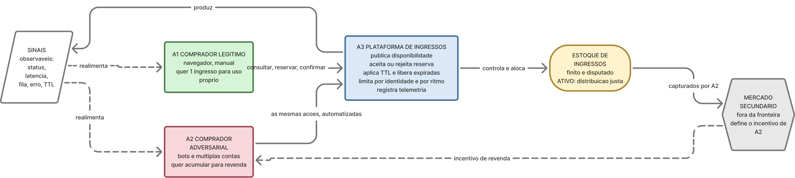
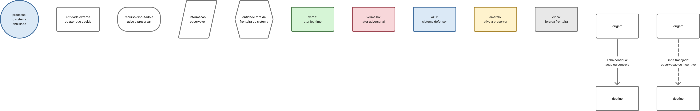

# 3.1 Descrição do sistema adversarial

Este documento estabelece a **realidade compartilhada** sobre a qual as demais seções do
trabalho são construídas. As definições abaixo valem como vocabulário fixo: os jogadores
do modelo estático (3.2), os participantes das rodadas (3.3) e os ativos afetados pelas
ameaças (3.4) são exatamente os definidos aqui.

---

## 1. Delimitação da interação analisada

O sistema analisado é uma **plataforma de venda e reserva de ingressos para eventos**.
O trabalho **não analisa a plataforma inteira** — não tratamos de cadastro, catálogo de
eventos, emissão fiscal, check-in na portaria ou reembolso.

A interação delimitada é:

> **A tentativa de um comprador obter um ingresso para um evento de alta demanda,
> durante a janela de abertura das vendas, enquanto a plataforma aplica regras de
> controle de disponibilidade para distribuir um estoque finito.**

Concretamente, o recorte cobre um único fluxo, com três passos:

```text
[1] CONSULTAR          [2] RESERVAR                    [3] CONFIRMAR
disponibilidade   →    bloqueio temporário do    →     pagamento conclui
de um setor            ingresso por um prazo T         a compra, ou a
                       (reserva com TTL)               reserva expira e o
                                                       ingresso volta ao estoque
```

**Por que este recorte:** ele possui estoque finito e disputado, uma regra explícita que
pode ser explorada (a reserva temporária e os limites por identidade), resposta
observável a cada tentativa (sucesso, rejeição, fila, erro) e escopo pequeno o
suficiente para virar código no Trabalho 2.

### O que está dentro e fora do escopo

| Dentro do escopo | Fora do escopo |
|---|---|
| Consulta de disponibilidade de um setor | Catálogo e busca de eventos |
| Criação e expiração da reserva temporária | Emissão de nota fiscal e repasse ao organizador |
| Limites por identidade e por sessão | Check-in / validação do ingresso na portaria |
| Fila de espera e controle de ritmo de requisições | Política de reembolso e cancelamento |
| Confirmação de pagamento como evento que converte reserva em compra | Meios de pagamento e antifraude bancário |
| Revenda como **motivação** do adversário | O mercado secundário em si (fora da plataforma) |

---

## 2. Atores

Adotamos **três atores com poder de decisão**. A separação entre comprador legítimo e
comprador adversarial é deliberada: ela é o que permite, nas seções seguintes, discutir
**efeitos colaterais de uma defesa sobre usuários legítimos** — exigência explícita do
enunciado nas seções 3.3 e 3.4.

### A1 — Comprador legítimo

Pessoa física que quer um ou poucos ingressos para consumo próprio. Age manualmente,
pelo navegador ou aplicativo, dentro da janela de venda. É o usuário que o sistema
existe para servir e é ele quem paga o custo das defesas mal calibradas.

### A2 — Comprador adversarial (cambista / operador de bot)

Agente que busca **acumular ingressos acima do que consumiria**, para revender no
mercado secundário com sobrepreço. Possui capital, conhecimento técnico e disposição
para investir em infraestrutura. É **racional e adaptativo**: observa as respostas da
plataforma, infere as regras que não estão documentadas e ajusta a estratégia entre
tentativas e entre eventos.

### A3 — Plataforma de ingressos (defensor)

O sistema que media a interação. Decide quanto estoque expor, se aceita ou rejeita cada
reserva, por quanto tempo a reserva vale, quantos ingressos cada identidade pode obter e
quanto atrito impor a cada tentativa. Opera sob incerteza: **não sabe, no momento da
decisão, se quem está solicitando é A1 ou A2.**

### Atores de contexto (não modelados como jogadores)

- **Organizador do evento:** define preço, lotes e o tamanho do estoque. Pressiona pela
  venda rápida e integral, o que limita o quanto de atrito a plataforma pode impor.
- **Mercado secundário:** define o preço de revenda e, portanto, o retorno esperado de
  A2. Não toma decisão dentro do sistema, mas é a fonte do incentivo do adversário.

---

## 3. Objetivos de cada ator

| Ator | Objetivo |
|---|---|
| **A1 — Comprador legítimo** | Obter o ingresso desejado com esforço e incerteza razoáveis, sem precisar de meios técnicos especiais |
| **A2 — Comprador adversarial** | Maximizar a quantidade de ingressos de alto valor capturados, minimizando o custo por ingresso e o risco de perder contas ou pedidos |
| **A3 — Plataforma** | Distribuir o estoque conforme as regras anunciadas, preservando justiça e disponibilidade, sem bloquear compradores legítimos nem inviabilizar a venda |

O conflito é **parcial, não total**: A2 e A3 concordam que os ingressos devem ser
vendidos; discordam sobre **quem** deve recebê-los e **a que custo**. A1 e A2 competem
diretamente pelo mesmo estoque finito. A1 e A3 têm objetivos alinhados, mas A3 não
consegue distinguir A1 de A2 com certeza — e é exatamente essa incerteza que A2 explora.

---

## 4. Ativo a ser preservado

**Ativo principal:**

> **A distribuição justa e controlada do estoque finito de ingressos** — isto é, a
> propriedade de que a alocação dos ingressos resulte das regras anunciadas pela
> plataforma, e não da capacidade técnica de automatizar tentativas.

Ativos secundários, derivados do principal:

| Ativo | O que significa neste sistema | Quem o ameaça |
|---|---|---|
| **Justiça da alocação** | O resultado reflete as regras anunciadas, não a assimetria técnica entre compradores | A2, ao converter capacidade computacional em vantagem de alocação |
| **Disponibilidade do estoque** | Ingressos não vendidos permanecem efetivamente acessíveis a quem quer comprar | A2, ao imobilizar estoque em reservas que não pretende pagar |
| **Integridade das reservas** | Uma reserva corresponde a exatamente um ingresso, e expira quando deve | Condições de corrida exploradas deliberadamente |
| **Confiança no processo** | O comprador acredita que tentar vale a pena | Ambos: A2 ao esvaziar o estoque, A3 ao impor atrito excessivo |

---

## 5. Ações e capacidades

### A1 — Comprador legítimo

- Consultar a disponibilidade de um setor do evento
- Selecionar setor e quantidade
- Solicitar uma reserva temporária
- Concluir o pagamento dentro do prazo da reserva
- Repetir a tentativa após uma rejeição (manualmente, poucas vezes)
- Aguardar em fila de espera, se houver
- Desistir

### A2 — Comprador adversarial

Possui **todas** as capacidades de A1, e adicionalmente:

- **Automatizar** as requisições, eliminando o tempo de reação humano
- **Paralelizar** dezenas ou centenas de sessões simultâneas
- **Multiplicar identidades**: criar ou adquirir contas, usar documentos de terceiros
- **Rotacionar origem**: trocar IP, dispositivo e *fingerprint* entre tentativas
- **Monitorar** o endpoint de disponibilidade em alta frequência, detectando a abertura
  do lote antes de qualquer humano
- **Imobilizar estoque**: abrir muitas reservas e deixá-las expirar, ou renová-las,
  retirando ingressos de circulação sem pagar por eles
- **Calibrar o comportamento** para se parecer com tráfego humano (intervalos irregulares)
- **Terceirizar** a resolução de CAPTCHA
- Revender os ingressos obtidos fora da plataforma

### A3 — Plataforma

- Publicar (ou omitir) a disponibilidade de cada setor
- Aceitar ou rejeitar uma solicitação de reserva
- Definir o prazo de validade (TTL) da reserva
- Liberar automaticamente as reservas expiradas
- Limitar a quantidade de ingressos por identidade
- Limitar o ritmo de requisições por sessão, conta ou origem (*rate limiting*)
- Inserir uma fila de espera com ordenação
- Exigir prova de humanidade (CAPTCHA) ou verificação de identidade
- Registrar telemetria de comportamento de cada sessão
- Cancelar pedidos e suspender contas *a posteriori*
- Escolher **o que comunicar** ao usuário em cada rejeição

> A última capacidade é a mais sutil e a mais importante para a seção 3.3: **toda
> resposta da plataforma é também um sinal**, e escolher a mensagem de erro é escolher
> quanta informação entregar ao adversário.

---

## 6. Informações observáveis

O que cada ator **consegue** e **não consegue** observar define o que ele pode aprender
entre uma rodada e a seguinte.

### A1 — Comprador legítimo observa

- A disponibilidade exibida na tela
- O resultado da sua tentativa (aceita, rejeitada, em fila)
- A mensagem de erro apresentada
- A posição na fila e o tempo estimado de espera
- O tempo restante da sua reserva

**Não observa:** o estoque real, quantos concorrentes existem, nem por que foi rejeitado.

### A2 — Comprador adversarial observa

Tudo o que A1 observa, e ainda:

- **Códigos de status e latência** de cada resposta — e a diferença entre elas
- **Qual das suas contas ou IPs foi bloqueado, e após quantas tentativas** — o que revela
  a ordem de grandeza dos limiares de detecção
- O **instante exato** em que o estoque muda, por amostragem de alta frequência
- A **taxa de sucesso de cada estratégia**, medida sobre muitas tentativas
- Se uma rejeição é determinística ou probabilística (repetindo a mesma requisição)
- O comportamento do sistema em **eventos anteriores**, acumulado entre vendas

**Não observa:** o código das regras de detecção, os limiares exatos, quais sessões foram
silenciosamente marcadas como suspeitas, nem o estoque real.

### A3 — Plataforma observa

- Volume, frequência e intervalo entre requisições por sessão, conta e origem
- Cabeçalhos, *fingerprint* de dispositivo e origem de rede
- Histórico de reservas por identidade
- A **taxa de conversão reserva → pagamento** de cada identidade — o indicador mais
  revelador de imobilização de estoque
- Correlações entre contas (mesmo meio de pagamento, mesmo dispositivo)

**Não observa:** a pessoa real por trás de uma conta, a intenção da compra, e — antes do
prazo da reserva expirar — se aquela reserva será paga. A plataforma **decide sob
incerteza e sob pressão de tempo**.

> **Assimetria central do sistema:** A2 observa o *resultado* das regras de A3 e pode
> inferir as regras. A3 observa o *comportamento* de A2, mas não sua identidade nem sua
> intenção. Nenhum lado enxerga o outro por completo, e ambos aprendem com o que veem.

---

## 7. Restrições e custos

| Ator | Restrições e custos |
|---|---|
| **A1** | Estoque finito; prazo curto para pagar; limite de ingressos por identidade; precisa estar disponível no horário exato da abertura; tolerância limitada a atrito (CAPTCHA, fila, erros) antes de desistir; custo emocional da frustração |
| **A2** | Custo de infraestrutura (servidores, proxies, contas, resolução de CAPTCHA); custo de aquisição e risco de perda de identidades ao serem banidas; capital imobilizado nos ingressos até a revenda; janela temporal estreita (o lote esgota em minutos); risco de cancelamento *a posteriori* do pedido; custo crescente se a plataforma exigir verificação de identidade |
| **A3** | Capacidade computacional sob pico de carga; **custo de falso positivo** — bloquear um comprador legítimo é caro em reputação e em receita; latência aceitável (atrito demais derruba a conversão); pressão do organizador por venda rápida e integral; custo de operação e moderação manual; exposição regulatória e de imagem se a venda for percebida como injusta |

> A restrição decisiva é a de A3: **ela não pode simplesmente maximizar a segurança.**
> Toda defesa que dificulta a vida de A2 também impõe custo a A1, e o orçamento de
> atrito que A1 tolera é pequeno. É essa tensão que torna o problema estratégico em vez
> de puramente técnico.

---

## 8. Tabela consolidada dos elementos principais

| Ator | Objetivo | Ações ou capacidades | Informações observáveis | Restrições ou custos |
|---|---|---|---|---|
| **A1 — Comprador legítimo** | Obter o ingresso desejado com esforço razoável | Consultar, selecionar, reservar, pagar, reenviar tentativa manual, aguardar na fila, desistir | Disponibilidade exibida, resultado da tentativa, mensagem de erro, posição na fila, TTL restante | Estoque finito, prazo curto de pagamento, limite por identidade, precisa estar online no horário, baixa tolerância a atrito |
| **A2 — Comprador adversarial** | Capturar o máximo de ingressos de alto valor ao menor custo e risco | Tudo de A1 + automação, paralelismo, múltiplas identidades, rotação de IP/dispositivo, monitoramento de alta frequência, imobilização de estoque, imitação de tráfego humano, terceirização de CAPTCHA | Tudo de A1 + latência e códigos de resposta, qual identidade caiu e após quantas tentativas, instante da liberação do lote, taxa de sucesso por estratégia, histórico entre eventos | Custo de infraestrutura e de contas, risco de banimento e de cancelamento do pedido, capital imobilizado, janela temporal estreita, custo de KYC |
| **A3 — Plataforma** | Distribuir o estoque conforme as regras anunciadas, preservando justiça e disponibilidade | Publicar disponibilidade, aceitar/rejeitar reserva, definir e aplicar TTL, liberar expiradas, limitar por identidade, *rate limiting*, fila de espera, CAPTCHA/verificação, telemetria, cancelar e suspender, escolher a mensagem de resposta | Volume e cadência de requisições, *fingerprint* e origem, histórico de reservas, taxa de conversão reserva→pagamento, correlação entre contas | Capacidade sob pico, custo alto de falso positivo, latência aceitável, pressão do organizador por venda rápida, custo de moderação, exposição reputacional |

---

## 9. Pressupostos do sistema e como podem falhar

O enunciado exige pelo menos dois pressupostos. Listamos cinco, porque cada um deles vira
um ponto de exploração rastreável na seção 3.4. **Um pressuposto é uma afirmação que o
sistema trata como verdadeira sem verificar.**

### P1 — Uma identidade corresponde a uma pessoa

O limite de ingressos por comprador só funciona se cada conta (ou CPF) representar um ser
humano distinto.

**Como falha:** contas criadas em massa com e-mails descartáveis; uso de documentos de
terceiros (familiares, laranjas); compra de contas antigas e "aquecidas". Quando P1 cai,
o limite por identidade deixa de limitar qualquer coisa — ele apenas define quantas
contas o adversário precisa manter.

### P2 — Uma reserva não paga é devolvida ao estoque e beneficia outro comprador

O TTL da reserva existe para que estoque bloqueado volte a circular.

**Como falha:** o adversário abre reservas em massa **sem intenção de pagar**, e as deixa
expirar ou as renova em ciclo. O estoque volta ao pool, mas volta para quem está
monitorando em alta frequência — ou seja, para o próprio adversário. O mecanismo
projetado para proteger a disponibilidade vira uma ferramenta de **negação de serviço
sobre o estoque**, e o comprador legítimo vê a disponibilidade oscilar e conclui que
"esgotou".

### P3 — A cadência e o volume de requisições revelam se o agente é humano

A detecção comportamental pressupõe que tráfego automatizado é estatisticamente distinto
de tráfego humano.

**Como falha:** nos dois sentidos. O adversário insere atrasos irregulares e imita
padrões humanos, ficando abaixo do limiar (**falso negativo**). E, no pico da abertura das
vendas, o comprador legítimo ansioso recarrega a página compulsivamente e **parece um
bot** (**falso positivo**). O limiar que separa os dois casos não existe de forma limpa.

### P4 — A disponibilidade exibida é a mesma para todos e reflete o estoque real

**Como falha:** por razões de desempenho, a disponibilidade é servida de cache ou de
réplicas, com atraso de propagação. Compradores diferentes veem números diferentes no
mesmo instante. Quem consulta a API diretamente, sem passar pela interface, enxerga o
lote **antes** de quem usa o site — vantagem que não foi concedida por nenhuma regra
anunciada.

### P5 — O custo de uma tentativa é semelhante para todos os compradores

A ideia implícita de "quem chegar primeiro leva" pressupõe uma disputa entre agentes com
capacidades comparáveis.

**Como falha:** para A1, cada tentativa custa atenção, tempo e desgaste; para A2, o custo
marginal de mais uma tentativa é praticamente zero. A mesma regra, aplicada igualmente
aos dois, produz resultados radicalmente desiguais. **Tratamento igual não produz
resultado justo quando as capacidades são assimétricas.**

### Resumo dos pressupostos

| ID | Pressuposto | Modo de falha | Ativo colocado em risco |
|---|---|---|---|
| **P1** | Uma identidade = uma pessoa | Contas em massa, documentos de terceiros, contas compradas | Justiça da alocação |
| **P2** | Reserva não paga volta a circular para outro comprador | Imobilização deliberada de estoque via reservas sem intenção de pagar | Disponibilidade do estoque |
| **P3** | Cadência de requisições distingue humano de bot | Automação que imita humano; humano em pico que parece bot | Justiça da alocação e confiança |
| **P4** | A disponibilidade exibida é única e fiel | Cache e réplicas com atraso; acesso direto à API | Justiça da alocação |
| **P5** | O custo de tentar é semelhante para todos | Automação zera o custo marginal da tentativa para o adversário | Justiça da alocação |

---

## 10. Diagramas de contexto

Esta seção entrega **duas figuras complementares**. A Figura 1 é o diagrama de contexto
na notação canônica (DFD nível 0) e responde ao item exigido pelo enunciado. A Figura 2
detalha o interior da interação e serve de insumo para as seções 3.3 e 3.4.

### Figura 1 — Diagrama de contexto (DFD nível 0)


**Fonte editável:** board FigJam do grupo (link em [`fontes/referencias.md`](../fontes/referencias.md)).
**Exportado:** `diagramas/contexto.svg` (vetorial) e `diagramas/contexto.png` (usado acima).

A notação segue a convenção de diagrama de contexto (DFD nível 0, Yourdon/DeMarco):

- O **processo 0**, no centro, é o sistema analisado por inteiro. Em um diagrama de
  contexto o sistema é sempre um único processo — seu interior só é aberto a partir do
  nível 1.
- As **entidades externas** são representadas por retângulos e ficam fora da fronteira do
  sistema.
- Os **fluxos de dados** são setas rotuladas. Sobre a aresta aparece apenas o
  identificador (`f1` a `f8`); o conteúdo de cada fluxo está no dicionário abaixo.
- **Depósitos de dados não aparecem em nível 0.** É por isso que o estoque de ingressos,
  que é o ativo central deste trabalho, **não** figura na Figura 1 — ele aparece na
  Figura 2.

> **Desvio declarado da notação.** Na regra estrita do DFD, fluxos ligam entidade externa
> a processo, nunca uma entidade externa a outra. Os fluxos **f7** e **f8**, entre A2 e o
> mercado secundário, violam essa regra e por isso aparecem tracejados. Mantivemos o
> desvio deliberadamente: esse par de fluxos é o **ciclo econômico que sustenta o
> incentivo de A2** e, sem ele, o diagrama não explicaria por que existe um adversário.
> Registramos a exceção em vez de omiti-la.

#### Dicionário de fluxos de dados

| Fluxo | Origem → Destino | Conteúdo |
|---|---|---|
| **f1** | A1 → Sistema | Consulta de disponibilidade de um setor, pedido de reserva, confirmação de pagamento |
| **f2** | Sistema → A1 | Disponibilidade exibida, resultado da tentativa, posição na fila, mensagem de erro, TTL restante da reserva |
| **f3** | A2 → Sistema | As mesmas requisições de f1, porém automatizadas, paralelizadas e distribuídas entre múltiplas identidades |
| **f4** | Sistema → A2 | As mesmas respostas de f2, porém lidas como **sinal de calibragem**: latência, código de status, qual identidade foi bloqueada e após quantas tentativas |
| **f5** | Organizador → Sistema | Definição do estoque, dos lotes, dos preços e da data de abertura das vendas |
| **f6** | Sistema → Organizador | Relatório de vendas e de desempenho do lote |
| **f7** | A2 ⇢ Mercado secundário | Ingressos capturados, colocados à venda com sobrepreço |
| **f8** | Mercado secundário ⇢ A2 | Preço de revenda praticado — define o retorno esperado e, portanto, quanto A2 aceita investir em infraestrutura |

> **f2 e f4 carregam exatamente o mesmo conteúdo.** Essa é a assimetria central do
> sistema: a plataforma não consegue responder de forma diferente a A1 e A2, porque no
> momento da resposta ela não sabe qual dos dois está do outro lado. O mesmo dado que
> orienta o comprador legítimo ensina o adversário onde está o limiar de detecção.

### Figura 2 — Fluxo interno da interação (complementar)



**Fonte editável:** mesmo board FigJam.
**Exportado:** `diagramas/contexto-fluxo.svg` e `diagramas/contexto-fluxo.png` (usado acima).

A Figura 2 abre o processo 0 e mostra o que a Figura 1 precisa omitir por convenção: o
**estoque de ingressos** como recurso disputado e sede do ativo, e os **sinais
observáveis** como saída que realimenta os dois compradores. Não é um DFD nível 1 formal
— é um diagrama de fluxo da interação, voltado a tornar visível o laço de realimentação
que a seção 3.3 transforma em rodadas.

### Legenda (vale para as duas figuras)



A notação carrega três dimensões independentes: a **forma** indica o tipo de elemento, a
**cor** indica o papel do elemento no conflito, e o **traço da linha** indica a natureza
do relacionamento.

#### Formas — tipo de elemento

| Forma | Significado | Ocorrências |
|---|---|---|
| **Círculo** | Processo — o sistema analisado por inteiro | Processo 0 (Figura 1) |
| **Retângulo** | Entidade externa (Figura 1) ou ator que toma decisão e adapta seu comportamento (Figura 2) | A1, A2, Organizador, Mercado (Fig. 1); A1, A2, A3 (Fig. 2) |
| **Estádio** (retângulo de extremidades arredondadas) | Recurso disputado; sede do ativo a preservar | Estoque de ingressos (Figura 2) |
| **Paralelogramo** | Informação observável — saída do sistema que realimenta os atores | Sinais observáveis (Figura 2) |
| **Hexágono** | Entidade fora da fronteira do sistema analisado | Mercado secundário (Figura 2) |

#### Cores — papel no conflito

| Cor | Significado | Ocorrências |
|---|---|---|
| **Verde** | Ator legítimo, que o sistema existe para servir | A1 |
| **Vermelho** | Ator adversarial | A2 |
| **Azul** | Sistema defensor | A3 |
| **Amarelo** | Ativo a preservar | Estoque de ingressos |
| **Cinza** | Fora da fronteira do sistema analisado | Mercado secundário |
| **Branco** | Elemento interno que não é ator nem ativo | Sinais observáveis |

#### Linhas — natureza do relacionamento

| Traço | Significado | Ocorrências |
|---|---|---|
| **Contínua** | **Ação ou controle direto:** um elemento age sobre o outro ou transfere um recurso | Fig. 1: `f1` a `f6`. Fig. 2: `A1 → A3`, `A2 → A3`, `A3 → estoque`, `A3 → sinais`, `estoque → mercado` |
| **Tracejada** | **Observação, realimentação ou incentivo:** informação que chega a um ator e pode mudar sua decisão na rodada seguinte, sem transferir recurso | Fig. 1: `f7`, `f8`. Fig. 2: `sinais ⇢ A1`, `sinais ⇢ A2`, `mercado ⇢ A2` |

> A distinção entre os dois traços é o que dá sentido ao modelo dinâmico da seção 3.3:
> **as linhas contínuas são o que acontece em uma rodada; as tracejadas são o que
> permite a adaptação para a rodada seguinte.**

### Como ler a Figura 2

- **A1** e **A2** atravessam a **mesma interface** da plataforma, com o mesmo repertório
  de ações — o que muda é a escala e o custo marginal de cada tentativa (pressuposto P5).
  É por isso que A3 não consegue separá-los no momento da decisão.
- Os **sinais observáveis** estão representados como um nó próprio, e não como simples
  setas de retorno, porque a resposta da plataforma **é ela mesma uma fonte de
  informação** para os dois compradores. Esse laço de realimentação é o que a seção 3.3
  transforma em rodadas.
- O **estoque de ingressos** é o recurso; a propriedade a preservar é a *justiça da sua
  distribuição*. O **mercado secundário** fica fora da fronteira do sistema, mas é ele
  que fecha o ciclo econômico de A2 e sustenta o incentivo para a próxima rodada.


## 11. Por que este caso é adversarial, e não apenas um erro ou acidente

Um sistema pode falhar por acidente. Este não é o caso analisado. A distinção importa
porque o enunciado penaliza explicitamente "tratar todo erro como ação adversarial".

**Contraexemplo (falha acidental, fora do escopo):** um *bug* de concorrência permite que
duas reservas simultâneas travem o mesmo assento, e a plataforma vende o ingresso duas
vezes. Há dano real, mas **ninguém escolheu** que isso acontecesse, o comportamento não
muda quando corrigido, e não existe reação à correção. É defeito, não adversidade.

O caso analisado é adversarial por cinco razões concretas:

1. **Há intenção e há escolha.** A2 não acumula ingressos por engano. Ele avalia custo,
   retorno e risco, e decide. É um agente otimizador, não uma falha.

2. **Os objetivos são genuinamente conflitantes.** Todo ingresso capturado por A2 é um
   ingresso a menos para A1. O estoque é finito: não existe arranjo em que ambos os
   objetivos sejam plenamente satisfeitos.

3. **A regra é o alvo, não o obstáculo acidental.** A2 não quebra o sistema — ele **usa o
   sistema exatamente como projetado**, em volume e velocidade que o projeto não previu.
   A reserva temporária funciona perfeitamente; é justamente por funcionar que ela pode
   ser transformada em ferramenta de imobilização de estoque. Não há erro a corrigir: há
   um incentivo a redesenhar.

4. **Há aprendizado dos dois lados.** Cada resposta da plataforma — um bloqueio, um
   CAPTCHA, uma mensagem de erro específica, um atraso — informa A2 sobre onde está o
   limiar. Cada defesa nova produz uma contramedida nova. Um acidente não se adapta à
   correção; um adversário se adapta, e é essa adaptação que a seção 3.3 modela.

5. **A defesa tem custo sobre terceiros.** Endurecer a regra contra A2 atinge A1, porque
   A3 não consegue distingui-los no momento da decisão. Isso não é um efeito colateral
   de um *bug*: é a consequência estrutural de decidir sob incerteza contra um oponente
   que escolhe deliberadamente se parecer com o usuário legítimo.

> **Síntese:** o que torna este sistema adversarial não é a existência de uma falha, mas
> a existência de **um agente que lucra com a regra funcionando como projetada, e que
> reage a toda tentativa de impedi-lo.**

---

## 12. Interfaces de fronteira

Registro das superfícies por onde a interação atravessa o limite do sistema. Serve de
insumo direto para o diagrama de superfície de ataque (seção 3.4). **A identificação
dos pontos de exploração e a avaliação de risco não pertencem a esta seção.**

| # | Interface | Quem acessa | Pressupostos envolvidos |
|---|---|---|---|
| **F1** | Consulta de disponibilidade de um setor | A1, A2 | P4, P5 |
| **F2** | Criação de reserva temporária | A1, A2 | P1, P2 |
| **F3** | Expiração e devolução automática da reserva | Plataforma (temporizador) | P2 |
| **F4** | Confirmação de pagamento | A1, A2 | P1 |
| **F5** | Cadastro e autenticação de identidade | A1, A2 | P1 |
| **F6** | Fila de espera e ordenação de atendimento | A1, A2 | P3, P5 |
| **F7** | Mensagens e códigos de resposta devolvidos ao cliente | A1, A2 | P3 |

---
