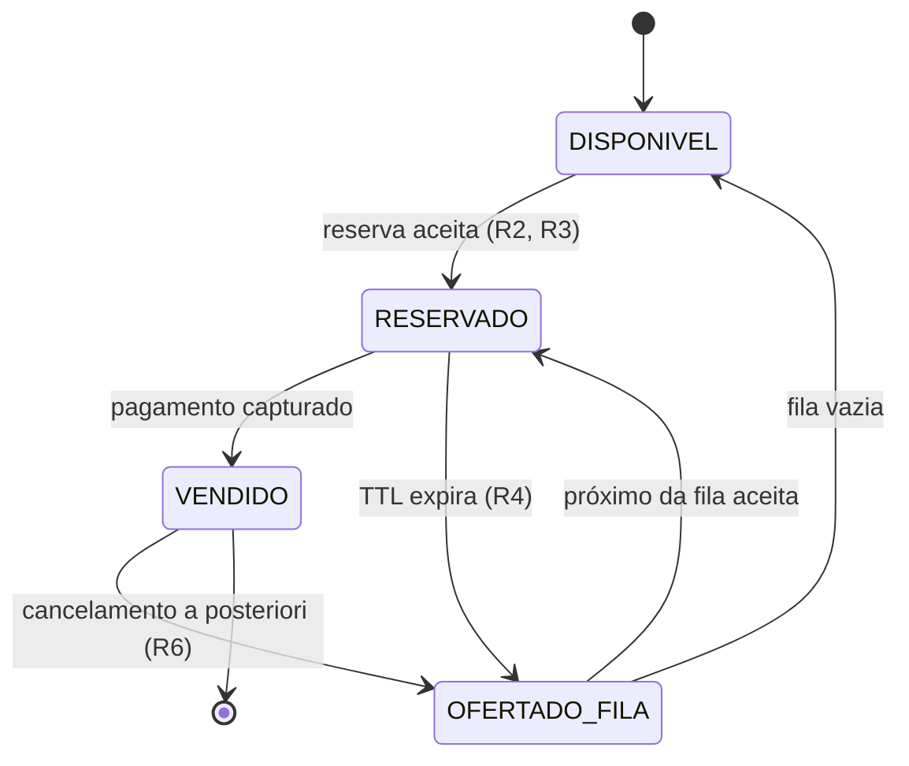

# Resposta e resiliência — ameaça prioritária

## Ameaça escolhida

A ameaça de maior prioridade é a **imobilização de estoque por reservas sem intenção de
pagar**, que explora o pressuposto **P2** (OWASP OAT-021, *Denial of Inventory*).

> Um **comprador adversarial (A2)** pode **abrir reservas em massa e deixá-las expirar,
> recapturando o estoque quando ele volta**, por meio da **criação de reserva temporária
> (F2) e da expiração automática (F3)**, aproveitando o pressuposto de que **uma reserva
> não paga volta a circular para outro comprador (P2)**, causando **a retirada do estoque
> de circulação e sua concentração em quem monitora em alta frequência** sobre a
> **disponibilidade do estoque e a justiça da alocação**.

> **Pendente de alinhamento:** o ID do cenário e sua formulação final vêm de
> [`ameacas.md`](ameacas.md), e a prioridade, da tabela de [`riscos.md`](riscos.md). O
> texto acima é provisório e deve ser substituído pela versão daquele arquivo.

**Por que é a prioritária.** É a única ameaça que atinge os dois ativos ao mesmo tempo:
tira ingressos de circulação (disponibilidade) e os devolve a quem tem automação (justiça).
É também a mais barata para A2: o sistema **funciona como projetado**, e reservar não custa
nada a quem não pretende pagar. Por fim, A1 vê o estoque oscilar e conclui que "esgotou",
o que corrói a confiança no processo (seção 3.1, seção 4).

**Ponto de partida.** A rodada 3 do modelo dinâmico já descreve a primeira reação de A3
(TTL menor, limite por cluster, pré-autorização, mensagem genérica, cancelamento
*a posteriori*). Esta seção trata essa reação como base e a redesenha. A rodada 3 encarece
a imobilização; o redesenho abaixo ataca **a falha do pressuposto em si** — o estoque
liberado volta para quem está monitorando.

---

## 1. Como o sistema poderia responder

A resposta combina controles que agem sobre pontos diferentes da imobilização. Nenhum
deles sozinho resolve; o conjunto muda o incentivo.

| # | Controle | Interface | O que ataca |
|-:|---|---|---|
| **R1** | **Devolução pela fila, não pelo estoque público.** Um ingresso cuja reserva expira não volta à disponibilidade exibida (F1): é oferecido ao próximo da fila de espera sorteada (F6) | F3, F6 | A recaptura. Monitorar F1 em alta frequência deixa de render ingressos liberados |
| **R2** | **Limite de reservas ativas** por identidade e por cluster de contas correlacionadas (por exemplo, uma reserva ativa por conta) | F2 | A escala. Imobilizar *n* ingressos exige *n* identidades ativas ao mesmo tempo |
| **R3** | **Reservar custa algo:** pré-autorização do cartão no ato da reserva, ou pagamento imediato via Pix como alternativa para quem não tem cartão | F2, F4 | O custo zero de reservar sem pagar (P5) |
| **R4** | **TTL curto com prorrogação única** quando o pagamento já foi iniciado (por exemplo, 5 min + 5 min se a autenticação bancária está em curso) | F3, F4 | O tempo de imobilização, sem punir quem paga devagar |
| **R5** | **Perda de prioridade, não bloqueio:** uma conta com reservas expiradas repetidas vai para o fim da fila *naquele evento* | F6 | A repetição do ciclo reserva → expira → reserva, com uma penalidade reversível |
| **R6** | **Controle do sinal:** mensagem genérica em toda rejeição (F7) e cancelamento *a posteriori* só para clusters confirmados | F7 | O aprendizado de A2 sobre os limiares (lição da rodada 1) |

### Observabilidade: o que A3 passa a monitorar

A resposta só se sustenta se A3 souber quando ela parou de funcionar. Os indicadores abaixo
saem da telemetria já descrita na seção 3.1 (seção 6):

| Indicador | O que sinaliza |
|---|---|
| Conversão reserva → pagamento, por conta e por cluster | Imobilização (conversão muito abaixo da média) |
| Fração do estoque em reserva ativa ao longo da abertura | Quanto do estoque está fora de circulação a cada instante |
| Periodicidade na disponibilidade (picos a cada TTL) | Ciclo de recaptura — deve desaparecer com R1 |
| Taxa de expiração por meio de pagamento | Se a expiração se concentra em quem não tem cartão, R3 está pesando sobre A1 |
| Desistência de A1 após rejeição ou expiração, e contestações de cancelamento | Falsos positivos e esgotamento do orçamento de atrito |

Os dois últimos indicadores medem o **custo da defesa**, não o ataque. Sem eles, A3 só
vê o lado em que está ganhando.

### Mudança de incentivo

A condição econômica do modelo dinâmico diz que A2 continua enquanto:

```text
n × q × (preço de revenda − preço de face)  >  custo de infraestrutura + custo de identidades + perdas esperadas por cancelamento
```

Imobilizar é atraente porque permite reservar muito (*n* alto) e só pagar os melhores
assentos, sem custo pelo que expira. Cada controle mexe em um termo:

- **R1** elimina o retorno da recaptura: reservar, deixar expirar e pegar de novo deixa de
  funcionar, porque o ingresso liberado vai para a fila e não para quem monitora.
- **R2** amarra *n* ao número de identidades: cada ingresso imobilizado passa a custar uma
  conta, e é o termo **custo de identidades** que cresce.
- **R3** transforma reservar em capital retido, e R5 transforma cada expiração em perda de
  posição — os dois somam ao lado direito.
- **R6** torna as **perdas por cancelamento** imprevisíveis, o que dificulta A2 calcular se
  a estratégia compensa.

O efeito pretendido não é impedir A2 de comprar, e sim tirar a **imobilização** do
repertório: se reservar sem pagar não rende nada, A2 só ganha comprando de verdade — o que
o devolve para o limite por identidade e para a disputa sobre P1.

---

## 2. Que informação essa resposta revelaria

Toda resposta é também um sinal (f2 = f4, seção 3.1). O que A2 consegue aprender:

| Controle | O que A2 observa | Como reduzir o vazamento |
|---|---|---|
| **R1** | Ingressos que expiram não reaparecem na disponibilidade; monitorar F1 não rende mais nada | Nenhum — o vazamento é desejável. A2 aprender que a recaptura morreu é exatamente o objetivo |
| **R2** | Tentando uma segunda reserva com a mesma conta, descobre o limite de reservas ativas | Limite anunciado publicamente: é regra, não detecção, e escondê-lo só confundiria A1 |
| **R3** | O valor e a duração da pré-autorização aparecem na fatura do cartão | Inevitável; o custo é o próprio objetivo |
| **R4** | Que existe prorrogação, e qual etapa a dispara | Prorrogação condicionada a um evento do provedor de pagamento, que A2 não consegue simular sem iniciar o pagamento |
| **R5** | Comparando posições na fila entre contas, pode inferir que contas com expirações caem para o fim | Efeito estatístico e atrasado: só aparece comparando muitas contas em várias aberturas |
| **R6** | Que a rejeição não diz o motivo, e que cancelamentos chegam dias depois | O próprio controle é a redução do vazamento |

A distinção que importa: **R1, R2 e R3 são regras anunciadas**, e não há problema em A2
conhecê-las, porque conhecê-las não ajuda a contorná-las. **R5 e R6 são detecção**, e
perdem valor quando A2 descobre o limiar — por isso o sinal delas é genérico e atrasado.
É a separação entre o que a rodada 1 errou (expor o limiar de uma detecção) e o que é
legítimo expor (uma regra igual para todos).

---

## 3. Como o adversário poderia se adaptar na rodada seguinte

Sem a recaptura, A2 mantém o objetivo e muda a ação, como no modelo dinâmico:

1. **Pulverizar a imobilização em identidades reais.** Com uma reserva ativa por conta,
   imobilizar exige muitas contas que não se correlacionem — contas aquecidas ou
   laranjas, cada uma com cartão próprio. É a adaptação da rodada 4, antecipada: a disputa
   migra de **P2** para **P1**.
2. **Absorver a pré-autorização.** Para A2 com capital, a pré-autorização é dinheiro parado
   por minutos, não um custo. Cartões virtuais descartáveis permitem um cartão por conta.
3. **Camuflar a conversão.** Pagar uma fração das reservas para manter a conversão do
   cluster acima do limiar de suspeita, revendendo o que pagou.
4. **Ocupar a fila em vez do estoque.** Se o ingresso liberado vai para a fila, ter muitas
   posições na fila passa a valer mais. A2 volta a multiplicar contas para ocupar posições
   — a mesma lógica de "cada conta é um bilhete" da rodada 2.
5. **Trocar imobilização por compra.** Se reter não compensa, A2 compra e revende. A
   ameaça deixa de ser negação de estoque e vira **acumulação** dentro do limite por
   identidade — que depende de quantas identidades A2 controla.

As cinco adaptações convergem para o mesmo lugar: **o custo de identidade**. É ali que a
corrida continua, e é ali que a próxima resposta de A3 (verificação seletiva, rodada 4)
precisa atuar.

---

## 4. Efeitos colaterais sobre usuários legítimos

A3 não distingue A1 de A2 no momento da reserva, então todo controle atinge os dois:

| Controle | Efeito sobre A1 | Mitigação no próprio desenho |
|---|---|---|
| **R1** | Quem esperava "pegar um ingresso que voltou" perde essa chance | É o efeito pretendido: o ingresso vai para outro A1 na fila, não para quem recarrega mais rápido |
| **R2** | Quem quer comprar para um grupo em reservas separadas não consegue | A reserva única aceita até o limite de ingressos por identidade (4) |
| **R3** | Exclui quem não tem cartão de crédito, ou bloqueia parte do limite de quem tem | Pix imediato como caminho sem cartão; pré-autorização liberada assim que a reserva expira |
| **R4** | Prazo curto pune quem paga devagar | Prorrogação única quando o pagamento já começou |
| **R5** | Um A1 cujo cartão foi recusado duas vezes cai para o fim da fila | Penalidade só a partir de várias expirações, válida só no evento corrente e nunca convertida em bloqueio |
| **R6** | A1 não sabe por que foi rejeitado; um cancelamento indevido é o falso positivo mais caro | Canal de contestação com resposta antes do evento; cancelamento só para cluster confirmado, nunca para conta isolada |

O efeito colateral **mais grave continua sendo o cancelamento *a posteriori*** sobre uma
conta legítima: o comprador achava que tinha o ingresso. Por isso R6 é o controle com o
critério mais estrito e o único com canal de contestação obrigatório.

O efeito **somado** também conta. A1 já enfrenta fila e CAPTCHA (rodada 2). A resposta foi
desenhada para não adicionar nenhum passo novo ao caminho de quem reserva e paga em tempo:
R1, R2 e R5 são invisíveis para esse comprador, e R3 se confunde com o próprio pagamento.

---

## 5. Risco que continuaria existindo após a resposta

- **Imobilização distribuída em identidades reais.** A2 com muitas pessoas reais, cada uma
  com uma reserva e um cartão, continua imobilizando — em escala menor e a custo maior. O
  risco migra para P1 e é tratado pela verificação de identidade (rodada 4), não por esta
  resposta.
- **Atraso de detecção.** R5 e R6 dependem de padrões que só se confirmam ao longo de uma
  abertura. Na primeira abertura com uma estratégia nova, A2 opera antes de ser visto.
- **Adversário com capital.** A pré-autorização encarece quem tem pouco capital; para quem
  tem muito, é custo de oportunidade de minutos.
- **Falsos positivos residuais.** Por menor que seja o limiar, algum A1 terá expirações
  repetidas ou entrará em um cluster por compartilhar dispositivo ou cartão com parentes.
- **Acumulação por compra.** A resposta tira a imobilização do repertório, mas não impede
  A2 de comprar e revender dentro do limite por identidade. A ameaça muda de forma; o
  incentivo do mercado secundário (f8) continua fora do alcance de A3.

A probabilidade da imobilização cai, porque a recaptura deixa de render e cada ingresso
retido passa a custar uma identidade. O impacto de cada ocorrência também cai, porque o
ingresso liberado volta para a fila e não para o adversário. Na escala de
[`riscos.md`](riscos.md) (seção 4), o risco passa de **9 (3 × 3, alto)** para
**4 (2 × 2, médio)** — não chega à faixa baixa porque o que sobra depende de P1, e não da
reserva.

---

## 6. O que o sistema precisa continuar preservando

Qualquer adaptação futura de A3 deve manter as propriedades abaixo, mesmo sob pressão de
uma nova estratégia de A2:

1. **A alocação resulta das regras anunciadas.** Controles de detecção podem ser
   silenciosos, mas as regras que definem quem recebe o ingresso (limite por identidade,
   ordem da fila, prazo da reserva) são públicas e iguais para todos.
2. **Uma reserva corresponde a exatamente um ingresso e expira quando deve.** A devolução
   pela fila (R1) não pode criar uma janela em que o mesmo ingresso esteja oferecido a duas
   pessoas, nem uma em que não esteja oferecido a ninguém.
3. **Todo estoque liberado volta a circular em tempo limitado.** Mudar *para quem* o
   ingresso volta é legítimo; deixar de devolvê-lo seria a própria negação de estoque,
   agora causada pela defesa.
4. **Existe um caminho para A1 sem meios especiais.** Quem não tem cartão de crédito, paga
   devagar ou usa tecnologia assistiva precisa conseguir comprar.
5. **Penalidades são proporcionais e reversíveis.** Perder posição na fila é preferível a
   ser bloqueado; ser bloqueado é preferível a ter o pedido cancelado. Quanto mais grave o
   efeito, mais forte a evidência exigida e maior a necessidade de contestação.
6. **O custo da defesa é medido junto com o ataque.** Se a desistência de A1 sobe mais que
   a imobilização cai, a resposta está protegendo o estoque à custa do ativo que ele existe
   para servir.

O critério da seção 3.3 continua valendo: um controle se justifica quando **custa mais para
A2 do que para A1**. R1 é o caso exemplar — não custa nada a A1 e anula a vantagem inteira
da recaptura —, assim como a fila sorteada foi na rodada 2.

---

## Arquitetura para o Trabalho 2

O Trabalho 2 transforma esta resposta em código. Esta seção fixa **quais componentes
existem, qual controle cada um implementa e qual propriedade cada um precisa garantir** —
sem escolher linguagem nem *framework*, que são decisão do Trabalho 2.

### Componentes



**Fonte editável:** `diagramas/arquitetura-t2.mmd` (Mermaid).

| Componente | Interface | Controle | Responsabilidade |
|---|---|---|---|
| **Borda da API** | F1, F2, F4, F5, F7 | R6 | Autentica a sessão, aplica *rate limit* e devolve sempre a mesma mensagem genérica em rejeições. Único ponto que fala com o cliente |
| **Disponibilidade** | F1 | R1 | Exibe só ingressos em estado `DISPONIVEL`. Um ingresso ofertado à fila não aparece |
| **Reserva** | F2 | R2, R3 | Verifica o limite de reservas ativas por conta e por cluster, pede a pré-autorização e faz a transição `DISPONIVEL → RESERVADO` de forma atômica |
| **Expiração** | F3 | R4 | Expira reservas vencidas; concede uma única prorrogação quando o Pagamento informa que a autenticação está em curso |
| **Redistribuição** | F3 → F6 | R1 | Oferece o ingresso expirado ao próximo da fila; se ele não aceitar no prazo, ao seguinte; se a fila acabar, devolve ao estoque público |
| **Fila de espera** | F6 | R5 | Ordem sorteada antes da abertura; rebaixa para o fim as contas marcadas pelo Detector, só no evento corrente |
| **Pagamento** | F4 | R3, R4 | Pré-autoriza, captura ou libera. No Trabalho 2, é um simulador do provedor |
| **Identidade** | F5 | — | Cadastro e autenticação; fornece os dados de correlação (dispositivo, cartão) ao Detector |
| **Telemetria** | — | — | Registra cada transição de estado do ingresso e cada requisição, com conta, cluster e instante |
| **Detector** | — | R5, R6 | Calcula conversão reserva → pagamento por cluster e periodicidade da disponibilidade; marca contas, sem bloquear |
| **Moderação e contestação** | — | R6 | Decide cancelamentos *a posteriori* só para clusters confirmados e recebe contestações de A1 |
| **Painel de indicadores** | — | — | Exibe os indicadores da seção 1, incluindo os que medem o custo da defesa sobre A1 |

### Ciclo de vida do ingresso

A propriedade 2 da seção 6 — uma reserva corresponde a exatamente um ingresso e expira
quando deve — vira, no código, uma máquina de estados. Todo ingresso está em **exatamente
um** estado, e toda transição é atômica:



`OFERTADO_FILA` é o estado que implementa R1: o ingresso sai de `RESERVADO` sem passar por
`DISPONIVEL`, e por isso nunca fica visível para quem monitora F1. A propriedade 3 da
seção 6 (todo estoque liberado volta a circular em tempo limitado) exige que a oferta à fila
também tenha prazo — nenhum ingresso pode ficar parado em `OFERTADO_FILA`.

### O que o Trabalho 2 deve conseguir demonstrar

1. Um agente simulado que reserva sem pagar **não** recaptura o ingresso que expira.
2. Uma segunda reserva ativa da mesma conta é rejeitada, com a mesma mensagem de qualquer
   outra rejeição.
3. Nenhum ingresso é vendido duas vezes nem fica sem estado sob reservas concorrentes.
4. O Detector marca um cluster com conversão anômala, e a conta marcada perde posição na
   fila, sem ser bloqueada.
5. O painel mostra, para a mesma simulação, a imobilização e a desistência de compradores
   legítimos simulados.
