# 3.4 Superfície de ataque

Este documento responde a uma pergunta só: **onde exatamente o comportamento adversarial consegue interagir com o sistema?** Ele identifica os pontos de exploração e os liga à arquitetura. Os cenários de ameaça no formato do enunciado ficam em [`ameacas.md`](ameacas.md), a pontuação de probabilidade, impacto e risco em [`riscos.md`](riscos.md), e a resposta defensiva em [`resiliencia.md`](resiliencia.md). Por isso, aqui **não há notas de risco nem controles propostos**.

O vocabulário é o da seção 3.1 ([`contexto.md`](contexto.md)): atores A1 a A3 (seção 2), ativos (seção 4), pressupostos P1 a P5 (seção 9) e interfaces de fronteira F1 a F7 (seção 12). Os nomes dos componentes são os mesmos da arquitetura do Trabalho 2 ([`resiliencia.md`](resiliencia.md)), para que cada ponto possa ser localizado no código.

---

## 1. Que sistema está sendo analisado

O enunciado pede pontos "presentes no sistema ou nas rodadas modeladas". A superfície analisada é, portanto, a do sistema **antes do redesenho** da seção de resiliência:

- as **regras do estado inicial** do modelo dinâmico (3.3): limite de 4 ingressos por identidade, reserva com TTL de 10 minutos, sem controle de ritmo;
- mais os **controles acrescentados por A3 nas rodadas 1 e 2**: limite de 30 requisições por minuto por IP com resposta `429` explícita, fila de espera com ordem sorteada e CAPTCHA no passo de reserva.

Os controles da rodada 3 em diante e os controles R1 a R6 são respostas a esta superfície, e não fazem parte dela.

### Fronteira de confiança

Tudo o que chega do cliente é controlado pelo comprador, seja A1 ou A2: cabeçalhos, IP de origem, cadência, *fingerprint*, dados de cadastro e o momento de cada requisição. A interface do site e o aplicativo também ficam fora da fronteira, porque A2 pode ignorá-los e falar direto com a API. A fronteira de confiança é a **Borda da API**: o que está do lado de fora pode ser forjado, repetido e paralelizado a custo marginal próximo de zero (P5).

### Componentes e interfaces

| Componente | Interface | O que expõe para fora da fronteira |
|---|---|---|
| **Borda da API** | todas | Autenticação de sessão e controle de ritmo por IP (rodada 1) |
| **Disponibilidade** | F1 | Quantidade disponível por setor, servida de cache e réplicas |
| **Reserva** | F2 | Criação da reserva, verificação do limite por identidade e CAPTCHA (rodada 2) |
| **Expiração** | F3 | Nada é chamado diretamente; o temporizador devolve o ingresso à disponibilidade pública |
| **Pagamento** | F4 | Confirmação que converte a reserva em compra |
| **Identidade** | F5 | Cadastro e login; a identidade é a conta, com e-mail e CPF declarados |
| **Fila de espera** | F6 | Posição sorteada por conta antes da abertura (rodada 2) |
| **Mensagens de resposta** | F7 | Código, texto e latência de cada resposta, inclusive rejeições |
| **Estoque** | (interno) | Não é acessível diretamente; é o ativo que todos os fluxos acima alteram |

A **Telemetria** não é superfície: A2 não a lê nem a escreve diretamente. Ele só a influencia pelo comportamento que gera, e esse caminho aparece no ponto PE6.

---

## 2. Pontos de exploração

Cada ponto segue a cadeia **componente → interface → regra → ponto de exploração**, resumida na frase "a funcionalidade X depende da regra Y, criando o ponto de exploração Z". Um ponto de exploração é o lugar onde uma regra que funciona como projetada pode ser usada contra o ativo; ele não é ainda um cenário de ameaça, porque não diz quem age, com que intenção, nem com que impacto.

### PE1. Leitura da disponibilidade sem custo e com visões divergentes

| Componente | Interface | Regra | Ponto de exploração |
|---|---|---|---|
| Disponibilidade | F1 | A disponibilidade é pública, pode ser consultada sem custo e sem limite, e é servida de cache e réplicas com atraso de propagação | Consulta automatizada em alta frequência, direto na API, enxergando cada mudança do estoque antes de quem usa o site |

A consulta de disponibilidade depende da regra de que **ler o estoque é gratuito e todos veem o mesmo número**, criando um ponto em que **quem consulta mais vezes e mais perto da origem do dado vê o lote abrir e cada ingresso voltar antes dos outros**.

- **Pressupostos:** P4 (a disponibilidade exibida é única e fiel) e P5 (o custo de tentar é igual para todos).
- **Onde aparece:** rodada 1 (monitoramento de alta frequência). É também o sensor que permite a recaptura da rodada 3 (PE3).
- **Ativo exposto:** justiça da alocação.
- **O que A2 aprende por aqui:** o instante exato em que o estoque muda.

### PE2. Reserva que retém estoque sem custo

| Componente | Interface | Regra | Ponto de exploração |
|---|---|---|---|
| Reserva | F2 | Reservar retira o ingresso de circulação por 10 minutos sem custo algum. O limite de 4 ingressos vale por pedido, e nada limita quantas reservas uma identidade mantém ativas nem quantas vezes reserva de novo depois de expirar | Abertura de reservas em massa sem intenção de pagar, retendo o estoque enquanto A2 decide quais pagar |

A reserva temporária depende da regra de que **quem reserva pretende pagar**, criando um ponto em que **reservar vira uma forma gratuita de tirar ingressos de circulação**. A confirmação de pagamento (F4) reforça o ponto: como pagar é um passo separado, A2 escolhe depois quais reservas converter.

- **Pressupostos:** P2 (reserva não paga volta a circular para outro comprador) e P5.
- **Onde aparece:** rodada 3 (OWASP OAT-021, *Denial of Inventory*). O CAPTCHA acrescentado a F2 na rodada 2 põe um custo fixo por reserva, mas A2 o terceiriza; o ponto continua aberto.
- **Ativos expostos:** disponibilidade do estoque e justiça da alocação.
- **O que A2 aprende por aqui:** se a reserva foi aceita e quanto tempo ela dura.

### PE3. Devolução do ingresso em instante previsível e para o estoque público

| Componente | Interface | Regra | Ponto de exploração |
|---|---|---|---|
| Expiração | F3 (e de volta a F1) | Quando o TTL fixo de 10 minutos vence, o ingresso volta imediatamente à disponibilidade pública | Recaptura: quem sabe quando o ingresso vai voltar está consultando F1 nesse instante e o reserva de novo |

A expiração automática depende da regra de que **o ingresso liberado volta para quem estiver olhando**, criando um ponto em que **o instante e o destino da devolução são previsíveis para quem criou a reserva**. F3 não é chamada pelo cliente, mas A2 controla quando ela dispara, porque controla quando reservou. É uma superfície indireta: o adversário aciona o temporizador sem tocar nele.

- **Pressupostos:** P2 e P4.
- **Onde aparece:** rodada 3, onde a disponibilidade oscila em ciclos de exatamente 10 minutos. PE1, PE2 e PE3 juntos fecham o ciclo reserva → expira → recaptura.
- **Ativos expostos:** disponibilidade do estoque, justiça da alocação e confiança no processo (A1 vê o estoque oscilar e conclui que esgotou).
- **O que A2 aprende por aqui:** que a devolução é determinística e periódica.

### PE4. Limite por identidade apoiado em identidades baratas

| Componente | Interface | Regra | Ponto de exploração |
|---|---|---|---|
| Identidade e Reserva | F5 e F2 | O limite de 4 ingressos é contado por conta, e a conta exige apenas e-mail e CPF declarados, sem verificar que corresponde a uma pessoa distinta | Multiplicação de contas: o limite deixa de limitar quanto A2 obtém e passa a definir quantas contas ele precisa |

A regra de quantidade depende da regra de que **uma conta é uma pessoa**, criando um ponto em que **o custo de obter mais ingressos é o custo de criar ou comprar mais contas**.

- **Pressuposto:** P1 (uma identidade corresponde a uma pessoa).
- **Onde aparece:** rodada 2 (contas criadas em lote) e rodada 4 (contas aquecidas e, depois, laranjas). É o ponto onde a corrida armamentista da seção 3.3 se concentra.
- **Ativo exposto:** justiça da alocação.
- **O que A2 aprende por aqui:** quais contas caem e após quantas compras.

### PE5. Verificação do limite sob requisições simultâneas

| Componente | Interface | Regra | Ponto de exploração |
|---|---|---|---|
| Reserva | F2 | O limite é verificado em duas etapas: o sistema lê quantos ingressos a conta já tem e, depois, grava a nova reserva | Requisições paralelas da mesma conta passam todas pela leitura antes de qualquer gravação, e a conta ultrapassa o limite |

A verificação do limite depende da regra de que **as requisições de uma conta chegam uma de cada vez**, criando um ponto em que **o paralelismo, que A2 tem e A1 não tem, transforma uma janela de concorrência em ingressos extras**.

Este ponto não vem de um dos pressupostos P1 a P5, e sim de uma **fraqueza de implementação** (verificar e gravar sem atomicidade). Ele entra na superfície porque a seção 3.1 lista a integridade das reservas como ativo ameaçado por "condições de corrida exploradas deliberadamente". A diferença em relação ao contraexemplo da seção 3.1, seção 11, é a intenção: lá, a venda duplicada é um defeito que ninguém escolheu; aqui, A2 dispara as requisições simultâneas de propósito, mede quantas passaram e repete.

- **Fraqueza:** verificação e gravação não atômicas; agravada por P5.
- **Onde aparece:** presente no sistema, não modelado nas rodadas. É a propriedade que o item 3 do Trabalho 2 precisa demonstrar ("nenhum ingresso é vendido duas vezes nem fica sem estado sob reservas concorrentes").
- **Ativos expostos:** integridade das reservas e justiça da alocação.
- **O que A2 aprende por aqui:** quantas requisições simultâneas passam antes de o limite valer.

### PE6. Controle de ritmo com chave barata e limiar fixo

| Componente | Interface | Regra | Ponto de exploração |
|---|---|---|---|
| Borda da API | F1 e F2 | Limite de 30 requisições por minuto, contado por IP | Rotação de IP por proxies e cadência mantida logo abaixo do limiar; do outro lado, o humano ansioso que recarrega a página é bloqueado |

O controle de ritmo depende da regra de que **volume por IP separa bot de humano**, criando um ponto em que **a variável de controle é barata para A2 trocar e o limiar, uma vez conhecido, é fácil de respeitar**. O mesmo ponto atinge A1 no sentido oposto: um limiar fixo bloqueia quem age como bot sem ser.

- **Pressupostos:** P3 (a cadência revela se o agente é humano) e P5.
- **Onde aparece:** criado pela resposta de A3 na rodada 1 e contornado na rodada 2.
- **Ativos expostos:** justiça da alocação e confiança no processo (falso positivo sobre A1).
- **O que A2 aprende por aqui:** o limiar e qual variável o controla, por meio de PE7.

### PE7. Mensagens de resposta como oráculo

| Componente | Interface | Regra | Ponto de exploração |
|---|---|---|---|
| Mensagens de resposta | F7 | Cada rejeição devolve um código específico (`429`, limite de conta, sem estoque), de forma determinística e imediata | Cada requisição vira um experimento: repetindo-a, A2 descobre qual regra o barrou, em que limiar e por qual variável |

A comunicação com o cliente depende da regra de que **explicar a rejeição ajuda o comprador**, criando um ponto em que **a explicação é entregue igualmente a quem quer aprender a contornar a regra**. É a assimetria central da seção 3.1: f2 e f4 têm o mesmo conteúdo, e A3 não escolhe a quem responde.

- **Pressuposto:** P3, e a impossibilidade de A3 distinguir A1 de A2 no momento da resposta.
- **Onde aparece:** rodada 1, onde o `429` explícito entregou o limiar em minutos.
- **Ativos expostos:** nenhum diretamente; PE7 é o canal que torna PE4 e PE6 calibráveis. Expõe os limiares de detecção, que protegem todos os ativos.
- **O que A2 aprende por aqui:** a regra por trás de cada rejeição.

### PE8. Fila sorteada em que cada conta é um bilhete

| Componente | Interface | Regra | Ponto de exploração |
|---|---|---|---|
| Fila de espera | F6 | Antes da abertura, cada conta autenticada recebe uma posição sorteada | Ocupação da fila com muitas contas: a chance de A2 cresce com o número de contas, não com a velocidade |

A fila depende da regra de que **cada conta concorre com um bilhete e cada pessoa tem uma conta**, criando um ponto em que **a falha de P1 vira probabilidade de ganhar o sorteio**. A fila resolveu a vantagem de velocidade (PE1) e, com isso, deslocou a disputa para o número de identidades (PE4).

- **Pressupostos:** P1 e P5.
- **Onde aparece:** criado pela resposta de A3 na rodada 2; explorado a partir da rodada 3.
- **Ativo exposto:** justiça da alocação.
- **O que A2 aprende por aqui:** que a ordem é sorteada e que a variável que importa é quantas posições ocupa.

---

## 3. Diagrama de superfície de ataque

**Fonte editável:** `diagramas/superficie-de-ataque.mmd` (Mermaid). **Exportado:** `diagramas/superficie-de-ataque.svg` e `.png`.

**Como ler.** As cores seguem a legenda da seção 3.1: verde A1, vermelho A2, azul os componentes da plataforma (A3), amarelo o estoque. O retângulo tracejado **Borda da API** é a fronteira de confiança; as interfaces F1 a F7 ficam sobre ela. As **bandeiras laranja** são os pontos de exploração PE1 a PE8, ligadas por linha pontilhada laranja ao componente onde a regra explorada está. Linhas contínuas pretas são requisições e transições de estado; a linha pontilhada preta de F7 até os compradores é a resposta que volta como sinal, a mesma para A1 e A2. Os pontos com contorno mais grosso (PE6, PE7, PE8) foram **criados por respostas de A3** nas rodadas 1 e 2. A bandeira fica dentro da região (borda ou interior) em que a regra explorada é aplicada.

---

## 4. Rastreabilidade

### Pontos de exploração

| Ponto | Componente | Interface | Regra explorada | Pressuposto ou fraqueza | Rodada | Ativo exposto | Origem |
|---|---|---|---|---|-:|---|---|
| **PE1** | Disponibilidade | F1 | Leitura gratuita, ilimitada e servida de cache | P4, P5 | 1 | Justiça | Projeto original |
| **PE2** | Reserva | F2 (e F4) | Reserva sem custo, sem limite de reservas ativas | P2, P5 | 3 | Disponibilidade, justiça | Projeto original |
| **PE3** | Expiração | F3 → F1 | Devolução imediata, periódica e pública | P2, P4 | 3 | Disponibilidade, justiça, confiança | Projeto original |
| **PE4** | Identidade, Reserva | F5, F2 | Limite por conta, conta sem verificação | P1 | 2, 4 | Justiça | Projeto original |
| **PE5** | Reserva | F2 | Verificar e gravar sem atomicidade | Fraqueza de implementação; P5 | n/a | Integridade, justiça | Projeto original |
| **PE6** | Borda da API | F1, F2 | 30 req/min por IP | P3, P5 | 1, 2 | Justiça, confiança | Criado na rodada 1 |
| **PE7** | Mensagens de resposta | F7 | Rejeição específica e determinística | P3 | 1 | Limiares de detecção | Criado na rodada 1 |
| **PE8** | Fila de espera | F6 | Uma posição sorteada por conta | P1, P5 | 2, 3 | Justiça | Criado na rodada 2 |

### Cobertura das interfaces

| Interface | Pontos | Observação |
|---|---|---|
| **F1** Consulta de disponibilidade | PE1, PE3, PE6 | É o sensor de A2: por F1 ele vê o lote abrir e o ingresso voltar |
| **F2** Criação de reserva | PE2, PE4, PE5, PE6 | A interface com mais pontos, porque é onde o estoque muda de dono |
| **F3** Expiração e devolução | PE3 | Não é chamada pelo cliente, mas A2 controla quando dispara |
| **F4** Confirmação de pagamento | PE2 | Sem ponto próprio: contribui para PE2, porque permite decidir depois quais reservas pagar. Fraude com meios de pagamento está fora do escopo (seção 3.1, seção 1) |
| **F5** Cadastro e autenticação | PE4 | É onde P1 é aceito sem verificação |
| **F6** Fila de espera | PE8 | Só existe a partir da rodada 2 |
| **F7** Mensagens e códigos | PE7 | Não muda o estoque; muda o que A2 sabe |

### Cobertura dos pressupostos

| Pressuposto | Pontos |
|---|---|
| **P1** Uma identidade é uma pessoa | PE4, PE8 |
| **P2** Reserva não paga volta para outro comprador | PE2, PE3 |
| **P3** Cadência distingue humano de bot | PE6, PE7 |
| **P4** Disponibilidade é única e fiel | PE1, PE3 |
| **P5** O custo de tentar é igual para todos | PE1, PE2, PE5, PE6, PE8 |

Todos os pressupostos da seção 3.1 têm pelo menos um ponto, e P5 aparece em quase todos: a assimetria de custo não é um ponto isolado, e sim o que torna os outros lucrativos.

---

## 5. Como os pontos se combinam

Isoladamente, cada ponto dá pouco a A2. A exploração real encadeia pontos, e essas cadeias são o insumo para os cenários de [`ameacas.md`](ameacas.md):

| Cadeia | Pontos | O que A2 obtém |
|---|---|---|
| **Imobilização e recaptura** | PE2 → PE3 → PE1 | Retém o estoque sem pagar, sabe quando ele volta e o pega de novo. É a cadeia que sustenta a ameaça prioritária de [`resiliencia.md`](resiliencia.md) |
| **Escala por identidades** | PE4 → PE8, com PE5 | Converte contas em ingressos (limite) e em bilhetes (fila); o paralelismo de PE5 tira mais de cada conta |
| **Calibragem** | PE7 → PE6 → PE4 | Aprende os limiares pelas mensagens e passa a operar logo abaixo deles, com rotação de origem e de contas |
| **Antecipação** | PE1 → PE2 | Vê o lote abrir antes e reserva antes de qualquer humano |

---

## 6. A superfície cresce com a defesa

PE6, PE7 e PE8 não existiam no estado inicial. Eles foram criados pelas respostas de A3 nas rodadas 1 e 2: o controle de ritmo trouxe um limiar a descobrir, a mensagem explícita trouxe o canal para descobri-lo, e a fila sorteada trouxe um sorteio em que contas valem bilhetes. Cada controle novo fecha uma via e abre uma regra nova que pode ser explorada.

É a mesma conclusão da seção 3.3 vista pelo lado da arquitetura: **nenhuma defesa é definitiva**, porque toda defesa é também uma regra, e toda regra que A2 consegue observar passa a fazer parte da superfície. Por isso a superfície precisa ser revista a cada controle acrescentado, inclusive os controles R1 a R6 propostos em [`resiliencia.md`](resiliencia.md).

---

## 7. Limites desta análise

- A superfície é a da interação delimitada na seção 3.1. Catálogo, emissão fiscal, check-in, reembolso e antifraude bancário não foram analisados.
- Ataques à infraestrutura em si (negação de serviço volumétrica, invasão de servidores, roubo de credenciais de outros usuários) ficam fora: não dependem das regras de alocação e não são o conflito modelado nas seções 3.2 e 3.3.
- A regra exata do estado inicial (limite contado por pedido, cadastro só com e-mail e CPF, verificação do limite em duas etapas) é uma hipótese de projeto coerente com as rodadas, não a descrição de uma plataforma real.
- Os pontos não têm prioridade entre si nesta seção. A prioridade sai da pontuação de [`riscos.md`](riscos.md).
